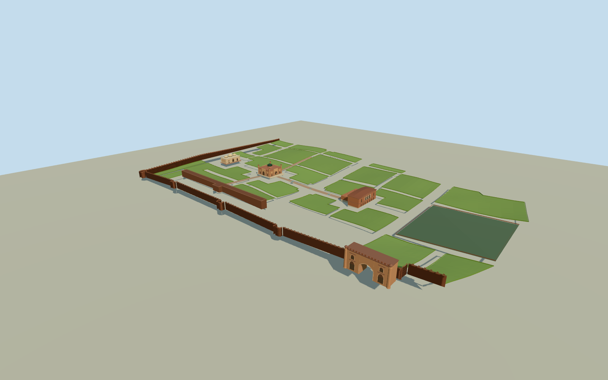

# Lalbagh Fort

Lalbagh Fort’s standing Mughal garden axis and southern fortified precinct, with Bibi Pari’s domed tomb, the three-domed mosque, the Bengal-roofed audience hall and hammam, and the southeast gateway.

Authoring state: **review-in-qa.json**. Current completion evidence is in [qa.json](qa.json) and the [completion ledger](../../../../qualla-structures/batches/qualla-003.PROGRESS.md).

- [Lalbagh Fort](https://qualla.com/lalbagh-fort/)

The 2026 images support the tomb and hall. Mosque details, the gate and wall sections use the mapped geometry and written heritage descriptions, with estimated details where dimensions or active surfaces are missing.

The model includes the four principal surviving structures and southern fortified walls. Garden beds follow the current mapped outlines. Elevations, less-visible masonry, parapet intervals and active water levels are approximations.

Build: `node content/worldgen/source/places/wh/wh0/lalbagh_fort/models/generate-lalbagh-fort.mjs`. Add `--check` to verify exact regeneration. 23060 triangles; 5 materials; no embedded photographs.
