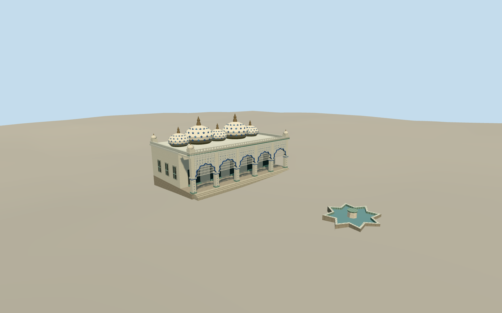

# Star Mosque

Star Mosque in old Dhaka has a tiled five-bay verandah, five white domes with blue stars and a fountain in its east forecourt.

Authoring state: **review-in-qa.json**. Current completion evidence is in [qa.json](qa.json) and the [completion ledger](../../../../qualla-structures/batches/qualla-003.PROGRESS.md).

- [Star Mosque](https://qualla.com/star-mosque/)

The current public-domain photo establishes the arcade, tile palette and ornament. The current dome heights, spacing and lantern details are approximate.

The fountain follows the survey envelope with an approximate star plan. The broader precinct, street furniture and temporary canopies are outside the model scope.

Build: `node content/worldgen/source/places/wh/wh0/star_mosque/models/generate-star-mosque.mjs`. Add `--check` to verify exact regeneration. 13763 triangles; 6 materials; no embedded photographs.
