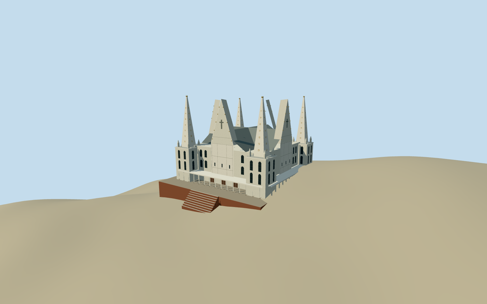

# Solomon’s Temple, Aizawl

Aizawl’s Solomon’s Temple, a white square of arched façades, pointed gables, four crowned corner towers and a ceremonial colonnade.

Authoring state: **review-in-qa.json**. Current completion evidence is in [qa.json](qa.json) and the [completion ledger](../../../../qualla-structures/batches/qualla-003.PROGRESS.md).

- [Solomon's Temple, Aizawl](https://qualla.com/solomon-s-temple-aizawl/)

The mapped church and porch fix the geographic outline. Roof ridge heights, crown silhouettes, small icons and the stair flights are reconstructed estimates.

The four façades follow the documented repeated arrangement. The other views, construction joints and carved surfaces are simplified.

Build: `node content/worldgen/source/places/wh/wh1/solomon_s_temple_aizawl/models/generate-solomon-s-temple-aizawl.mjs`. Add `--check` to verify exact regeneration. 11131 triangles; 6 materials; no embedded photographs.
