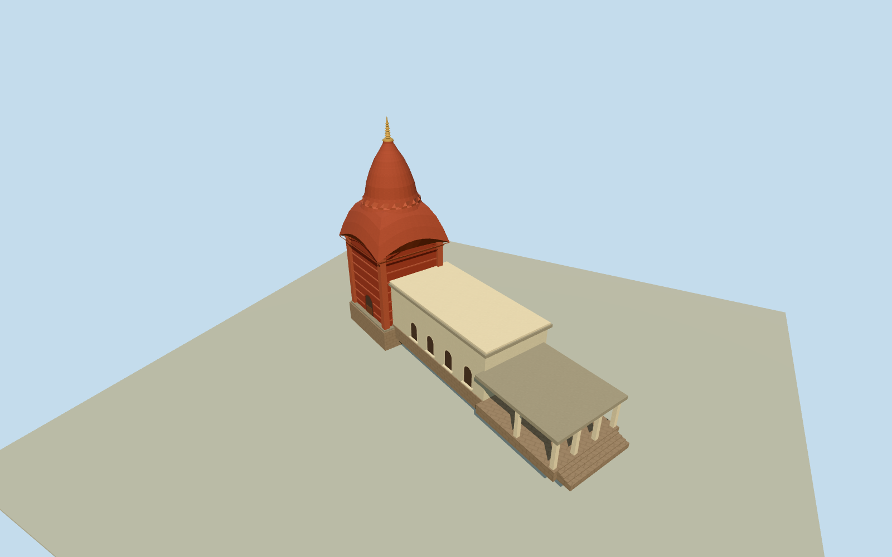

# Tripura Sundari Temple

Tripura Sundari’s historic red sanctuary with a curving Bengali roof, tall finial and lower west assembly hall.

Authoring state: **review-in-qa.json**. Current completion evidence is in [qa.json](qa.json) and the [completion ledger](../../../../qualla-structures/batches/qualla-003.PROGRESS.md).

- [Tripura Sundari Temple](https://qualla.com/tripura-sundari-temple/)

The shrine represents the pre-redevelopment temple. The sanctuary and connected west hall are included. Interior worship spaces, surrounding halls, new visitor facilities and the reservoir are outside scope.

The cleared doorway photograph establishes the red plaster and gold-toned arch. The written dimensions and architectural descriptions constrain the shrine shape. Exact roof profiles, pigments above the door and assembly hall details remain estimated.

Three aligned mapped roof outlines constrain the temple and west assembly hall. These are unnamed roof detections and support approximate exterior registration. The terrain is an original regional DEM and local grade is approximate.

Build: `node content/worldgen/source/places/wh/wh1/tripura_sundari_temple/models/generate-tripura-sundari-temple.mjs`. Add `--check` to verify exact regeneration. 4198 triangles; 5 materials; no embedded photographs.
