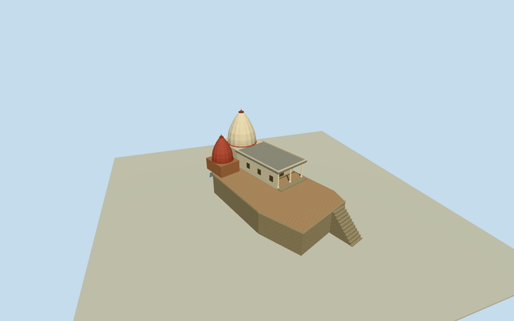

# Umananda Temple

The Umananda island temple with a ribbed white sanctuary, entrance hall, adjoining red shrine and hilltop terrace.

Authoring state: **review-in-qa.json**. Current completion evidence is in [qa.json](qa.json) and the [completion ledger](../../../../qualla-structures/batches/qualla-003.PROGRESS.md).

- [Umananda Temple](https://qualla.com/umananda-temple/)

The model represents the July 2024 sanctuary, attached entrance hall, nearby red shrine and terrace. Island vegetation, interior spaces, and separate lower campus buildings are outside scope.

Aerial images constrain roof colors, relative heights and forecourt arrangement. The red shrine and terrace positions, lower wall details and grade are estimates.

The native Copernicus DSM gives the original island relief at approximately 28 by 31 metre sample spacing. It does not resolve the smaller courtyards and steps.

Build: `node content/worldgen/source/places/wh/wh9/umananda_temple/models/generate-umananda-temple.mjs`. Add `--check` to verify exact regeneration. 2505 triangles; 5 materials; no embedded photographs.
