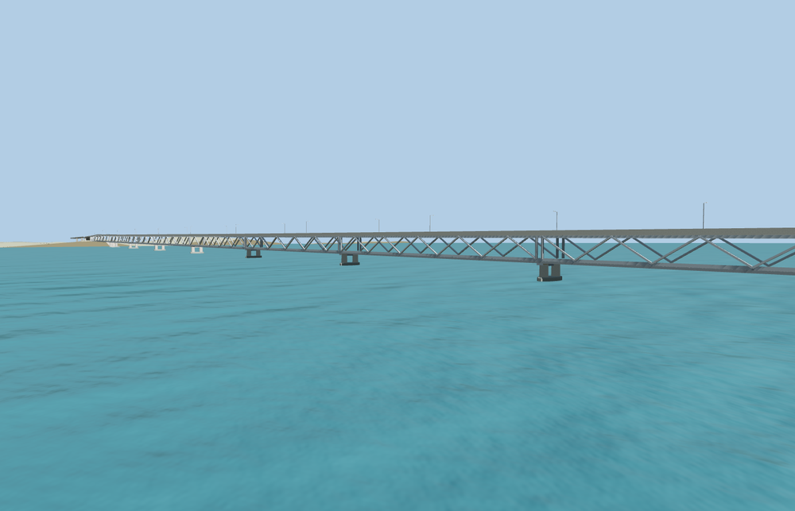

# Bogibeel Bridge

A long double-deck bridge crosses the Brahmaputra on paired concrete shafts and wide pier bases. Repeated steel trusses enclose both lower tracks. A dark three-lane highway with striped barriers and single-arm lamps runs above them.

The 74,074-triangle source rebuilds byte for byte. Skyline, district, street and close-up use 904, 3,822, 13,754, 49,250 triangles. Skyline and district total 426,596 bytes. Six GLBs validated and 36 current views were inspected.

Every tier passes 22 highway, 26 lower deck, six pier, six highway seam and four rail seam checks. The lower service roads retain at least 4.77 m of modeled clearance. Three neighboring tile probes confirm that each renders only its own bridge section. The viewer restores the mapped highway and rails if loading fails.

PMTiles controls the crossing length, highway alignment, two rail traces and the lower riverbank routes. Span spacing, truss sections and the bank transition grades are photo-based exterior estimates. The river surface and exposed pier height vary with the viewer terrain and water data. The railway is represented as visible geometry.

Rebuild with `node packages/worldgen/scripts/generate-bogibeel-bridge.mjs`. Append `--check` to compare exact bytes. Use `--ids=bogibeel_bridge` for targeted import, LOD, placement and readiness.
