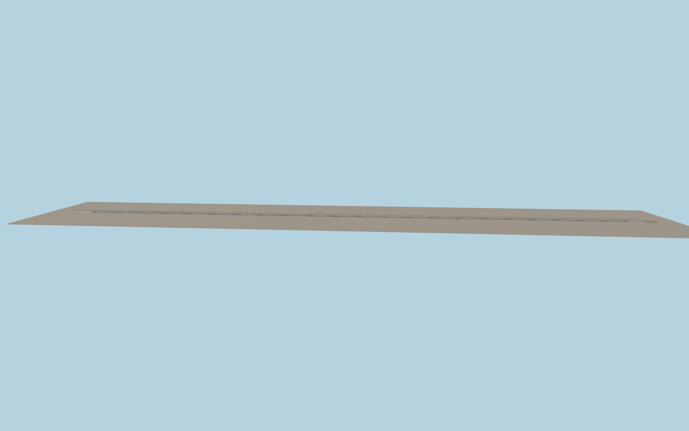

# Bogibeel Bridge

A long double-deck bridge crosses the Brahmaputra on paired concrete shafts and wide pier bases. Repeated steel trusses enclose both lower tracks. A dark three-lane highway with striped barriers and single-arm lamps runs above them.

Run `node packages/worldgen/scripts/generate-vushtrri-stone-bridge.mjs` to rebuild the source master. Append `--check` to compare the exact bytes. Use `--ids=bogibeel_bridge` for targeted import, LOD generation and placement.

PMTiles controls the crossing length, highway alignment, two rail traces and the lower riverbank routes. Span spacing, truss sections and the bank transition grades are photo-based exterior estimates.

The river surface and exposed pier height vary with the viewer terrain and water data. The railway is represented as visible geometry.

Original geometry follows the repository license. Map data is © OpenStreetMap contributors under ODbL-1.0 via Protomaps. Terrain samples are described in terrain-grid.json. Ordinary pictures stay local and are not redistributed or used as textures. Current acceptance is recorded in qa.json.
