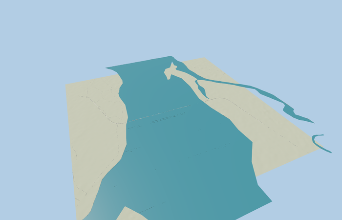

# Dr. Bhupen Hazarika Bridge

Reviewed 2026-10-26. **Scoped medium-fi exterior and approximate native placement complete.**

Inspected 53 current frames: 8 portable, 8 shared-material/geographic views, 24 medium-fi context/LOD views and 13 native images. The full curved crossing, continuous girder, regularized single-pier rhythm, flared heads, two asphalt lanes, raised walks, white barriers and yellow rails remain recognizable at their intended distances. Corrected two stale detail cameras and the review far plane. The skyline now includes actual girder sides and two-sided pier cards, improving shallow-angle visibility within 700 triangles. The detailed master and three nearer runtime files remain exact.

Two existing 256 px graphs, concrete_plain and metal_painted, provide metric surface detail and component tints. There are no private or embedded images, copied photograph pixels or downloaded meshes. Shared graph reads are deduplicated and runtime model/support disposal passes.

| Level | Triangles | Bytes | Draws |
| --- | ---: | ---: | ---: |
| skyline | 700 | 68796 | 1 |
| district | 3682 | 336840 | 1 |
| street | 15898 | 1542196 | 2 |
| closeup | 61574 | 6065172 | 2 |

The detailed master remains 153324 triangles / 18400876 bytes. Browser levels are 700 / 3682 / 15898 / 61574 triangles and 68796 / 336840 / 1542196 / 6065172 bytes. Initial skyline plus district is 405636 bytes, below phone and laptop targets. Physical-device timings remain unmeasured.

Exact-QID OSM way/206778254 supplies the full 42-point alignment. Anchor [95.675615338,27.796253085], heading pi/4: +X northeast along the crossing, +Z southeast, +Y up. The mapped route is 9169.809 m including both approach bends. Source origin 120 m, native water about 128.144 m and the photo-based deck profile are approximate standard-Mapzen visualization controls. Tested native connections meet expected deck height within 0.01501 m across all four LODs. One bounded automatic approach support keeps a coarse bank join visible; its dimensions are visualization support, not surveyed bridge construction.

Six GLBs pass validation without errors or warnings. The selected source rebuild preserves the original detailed master exactly. All 882 mesh probes, shared bindings, 30-tick simulation, native fit, load-failure and unload checks pass. Bulk captures remain local.

## Reconstruction limits

- Original picture-based exterior proportions; no bespoke surveys or engineering sources used.
- The 183-span approximately 50 m rhythm is a regularized reconstruction assumption, not a confirmed as-built span schedule.
- Exact girder sections, bearings, individual rail/post spacing, foundations, river stage and terrain contact are provisional.
- Ordinary pictures show different construction/opening states; temporary gantries, crowds, vehicles, signs and neighboring infrastructure are excluded.
- Physical ordinary-laptop and phone/tablet measurements remain pending.
- The basic semantic-road fixture draws an unrelated mapped ferry as a stripe over the water; that independent feature is retained. It is outside the authored bridge and is not a road-mode fidelity approval.
