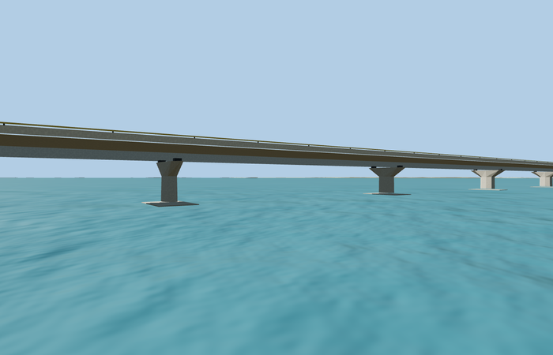

# Dr. Bhupen Hazarika Bridge

Full 42-point OSM route, 183 regularized spans, single piers with flared heads and bearings, continuous girder, two lanes, raised walks, striped curbs, white barriers and yellow top rails.

Editable geometry lives in models/; model-brief.json records the material library, four authored runtime levels, reference pictures and reconstruction limits. The detailed master is byte-identical to its inspected isolated draft. All GLBs are ignored generated outputs.

Regenerate with `node packages/worldgen/scripts/generate-authored-bridge-models.mjs --ids=dr_bhupen_hazarika_bridge`. Append `--check` to verify exact reconstruction. Import with `node packages/worldgen/scripts/import-structure-models.mjs --ids=dr_bhupen_hazarika_bridge`, then generate runtime levels with `node packages/tooling/scripts/generate-landmark-lods.mjs --ids=dr_bhupen_hazarika_bridge`.

## Review status

Current completion decisions are in qa.json and QA-REVIEW.md when present; the readiness catalog is authoritative. integration-review.json retains the earlier source-promotion checkpoint, including its original pending work. placement-draft.json preserves the proposed orientation, datum and bounded replacement rules. A source build alone grants no visual or geographic approval.

Original geometry uses the repository license. Map-derived controls: © OpenStreetMap contributors, ODbL-1.0. Reference photos retain their own rights and are not model textures.
