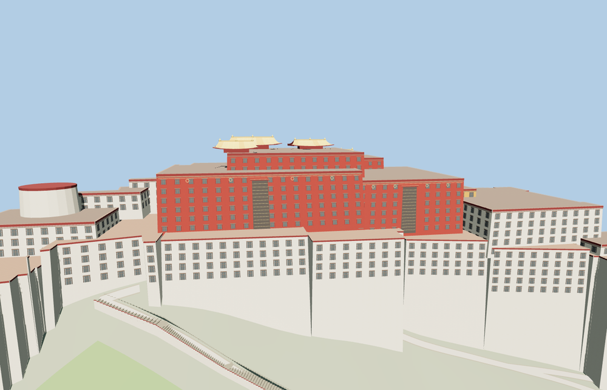

# Potala Palace

The crimson Red Palace and five gilt roof pavilions rise above the white retaining walls and east and west wings. Three stepped exterior routes follow the southern hill. An open White Palace court is edged by timber galleries and a tiered ceremonial entrance.

The 58,343-triangle source rebuilds byte for byte. Skyline, district, street and close-up use 977, 3,945, 15,333, 52,297 triangles. Skyline and district total 445,032 bytes. Six GLBs validated and 36 current views were inspected.

All four tiers pass five roof crest, six court floor, four gallery, 21 stair route and 13 retaining-wall checks. The viewer retains 64 independent building records and 59 transportation records. Failed loading restores the mapped palace footprint.

The mapped palace footprint, hilltop terrain and path junctions control placement. Building heights, the court plan, wall batter, and the stair profiles are exterior reconstructions from photographs. The open court and exterior stairs represent the visible route. The detailed model represents the rooflines and façades, including approximate window and gilt ornament spacing.

Rebuild with `node packages/worldgen/scripts/generate-potala-palace.mjs`. Append `--check` to compare exact bytes. Use `--ids=potala_palace` for targeted import, LOD, placement and readiness.
