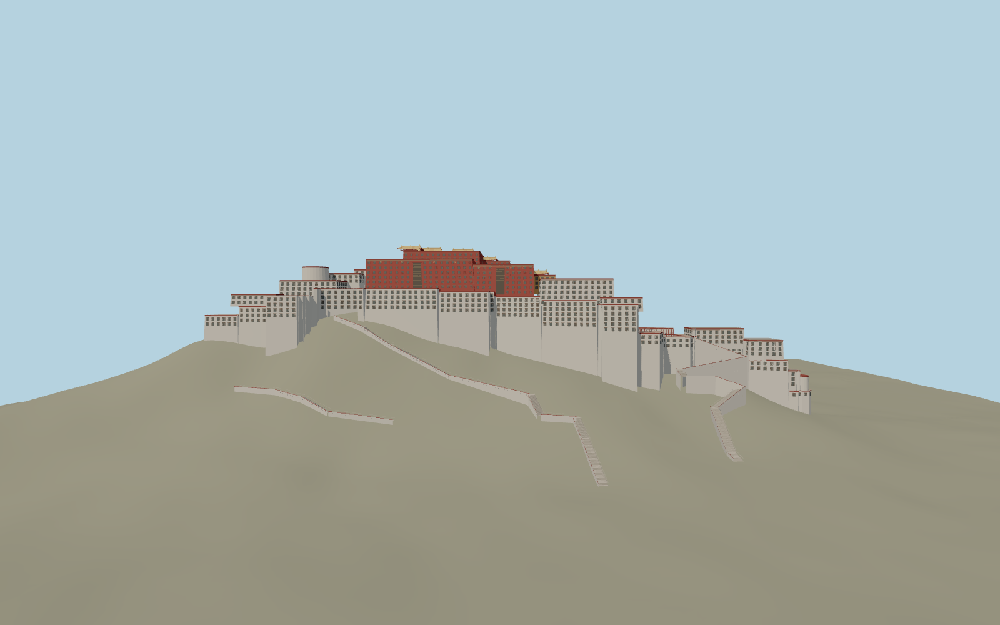

# Potala Palace

The crimson Red Palace and five gilt roof pavilions rise above the white retaining walls and east and west wings. Three stepped exterior routes follow the southern hill. An open White Palace court is edged by timber galleries and a tiered ceremonial entrance.

Run `node packages/worldgen/scripts/generate-potala-palace.mjs` to rebuild the source master. Append `--check` to compare the exact bytes. Use `--ids=potala_palace` for targeted import, LOD generation and placement.

The mapped palace footprint, hilltop terrain and path junctions control placement. Building heights, the court plan, wall batter, and the stair profiles are exterior reconstructions from photographs.

The open court and exterior stairs represent the visible route. The detailed model represents the rooflines and façades, including approximate window and gilt ornament spacing.

Original geometry follows the repository license. Map data is © OpenStreetMap contributors under ODbL-1.0 via Protomaps. Terrain samples are described in terrain-grid.json. Ordinary pictures stay local and are not redistributed or used as textures. Current acceptance is recorded in qa.json.
