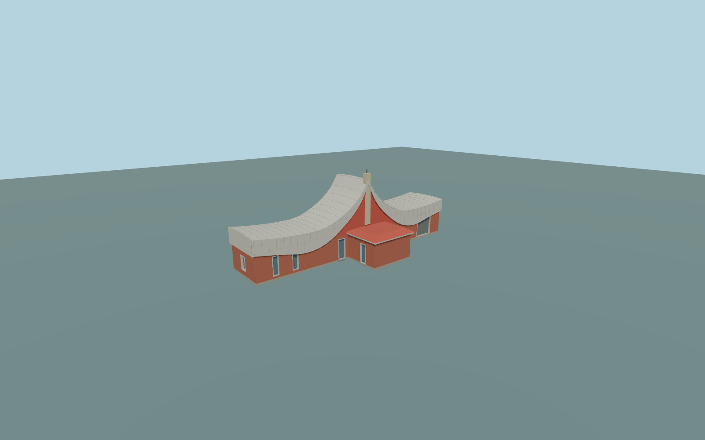

# Tanggula railway station

Complete distinctive Tanggula station headhouse exterior:long redbrick main bar andSSE projecting entrance annex,closed curved white panel canopy withupturned outerends andhigh center sail profile,pale center mast/short antenna,red triangular upper infill andlow red entrance hip cap withpale fascia,closed narrow blue-gray doors/windows andwide ribbed service shutter,andapproximate unseen rear andside returns. Panel joints,mast androof thickness aregeometry. Platforms/railings/signs,green forecourt gates,independent Tanggula monument andmountain remain native;no copied characters,logos orinterior.

Rebuild: `node packages/worldgen/scripts/generate-tanggula-railway-station.mjs`;append `--check` for exact source bytes. Select import/LOD/placement with `--ids=tanggula_railway_station`. Detailed source and four browser tiers are separate ignored GLB outputs.

Complete distinctive Tanggula station headhouse exterior:long redbrick main bar andSSE projecting entrance annex,closed curved white panel canopy withupturned outerends andhigh center sail profile,pale center mast/short antenna,red triangular upper infill andlow red entrance hip cap withpale fascia,closed narrow blue-gray doors/windows andwide ribbed service shutter,andapproximate unseen rear andside returns. Panel joints,mast androof thickness aregeometry. Platforms/railings/signs,green forecourt gates,independent Tanggula monument andmountain remain native;no copied characters,logos orinterior.

Current physical map footprint43.94m wide and15.69m wholedepth includingannex;main bar depthabout9m. No numeric native building height. Ordinary-photo proportions control4.8m main walls,4.9m annex walls/5.85m red hip,white roof end7.6m andcentral profile14.2m with.25m cross-crown,15.3m mast and16m antenna. These are approximate visualization controls,not surveyed dimensions. The catalog reference[91.649308,33.005496] isnear the2024 platform camera point,not theheadhouse center. One unmodified exterior annex sample [.7,12.5],5069.7953437625m,suppliesY=0;occupied floor+.35m/support-3m. Native station POI elevation5068m remains a separate source fact,not an imposed model altitude.

One complete2016 front building picture andone2024 platform context picture,current standard PMTiles andtwo unchanged global Terrarium tiles. Distinctive canopy/mast,red walls,entrance projection andvisible door/service openings are observed;hidden rear/side inventory,roof depth/joins andnumeric heights areoriginal medium-fi approximations. No copied lettering/ornament or mountain. Current native contact requiresactual inspection;exact historic thresholds,physical-device timings andnumerical LOD errors remainunmeasured. No bespoke research.

Five existing shared256px brick,granite,painted metal,lime plaster andpunched-window graphs in six material groups:painted metal has separate roof anddoor bindings. MetricUVs/linearcolors,no private orembedded images. Skyline retains allmass/roof/annex/mast withdouble-sided thin fascia andclosed windowpatches inone palettegroup. District addsreal closed recesses andclosed fascia thickness. Street addsmodeled frames,shutter ribs andsparse seams;close-up/master refine thecurved shell/panel joints. Detailed source remainsseparate.

Original geometry:repository license. Map:© OpenStreetMap contributors,ODbL-1.0;Protomaps. Standard terrain:terrain-grid.json. Ordinary pictures stay local and are not redistributed or used as textures. Current acceptance:qa.json.
