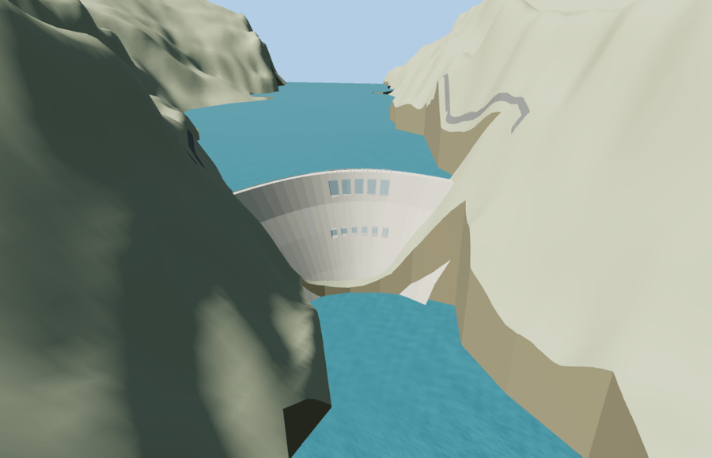

# Wudongde Hydropower Station

The model has a double-curved arch, narrow crest, five upper recessed spillway bays, six mid-level recessed outlets and crest hoists. The skyline tier preserves the five upper bays and hoists. The finer tiers add mid-level outlets, coping and crest rails.

The signed placement puts the 326.95 m arch inside the mapped dam extent and fixes its crest at 988 m. The Earth viewer renders a 975 m upstream pool, 855.32 m Jinsha tailwater and a separate 873.18 m stilling basin. Two bounded terrain grades keep the mapped channel and basin beds submerged. The mapped buried spill tunnel lines do not render on the surface.

The Earth fixture retains all three mapped service road records. The ground opening follows the upper central arch. Failed loading preserves the native layers. Eviction restores the ground and releases model geometry.

| Detail level | Triangles | Download bytes | Draws |
| --- | ---: | ---: | ---: |
| skyline | 906 | 70,740 | 5 |
| district | 3,322 | 243,500 | 6 |
| street | 5,558 | 412,448 | 6 |
| closeup | 7,922 | 592,592 | 6 |

Skyline and district total 314,240 bytes. Six GLBs pass Khronos validation and contain zero embedded images. Four shared material graphs bind in the viewer. The review covers 76 renders and 270 geographic samples.

Water stages and local bed grades are representative. The coarse raster leaves angular sections along the outer gorge and the downstream right shoulder. Underground works and gate motion are outside the modeled exterior.

The host supplies the matching Protomaps feature IDs and terrain samples fine enough to resolve the two graded beds.

[Mapped site frame](map-frame.json) · [Terrain and water fit](site-fit.json) · [QA evidence](qa.json)
