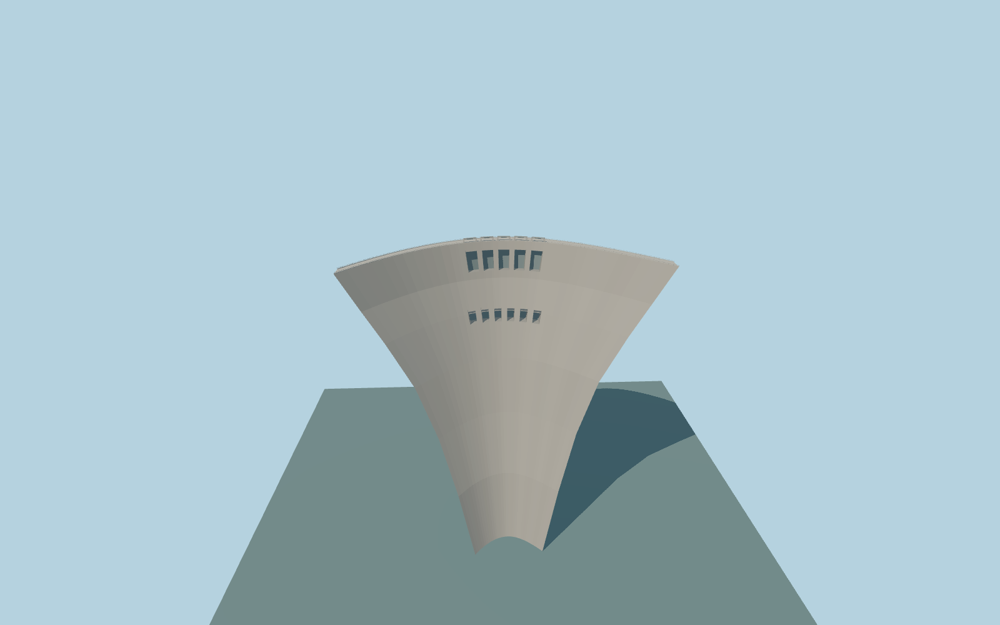

# Wudongde Hydropower Station

Wudongde’s thin double-curved concrete arch, crest railings and service structures, five upper spillway bays and six mid-level recessed outlets.

Rebuild: `node packages/worldgen/scripts/generate-wudongde-hydropower-station.mjs`;append `--check` for exact source bytes. Select import/LOD/placement with `--ids=wudongde_hydropower_station`. Detailed source and four browser tiers are separate ignored GLB outputs.

Fixed absolute crest 988 m and foundation 718 m on a local datum of 913.95816425 m. The visual fixture uses the 975 m normal pool. The standard viewer water sampler yields 870.67 m upstream and 855.32 m immediately downstream.

PMTiles supplies the shoreline break and separate service road ends. The exact crest centerline and buried abutment geometry are inferred within the retained OpenStreetMap dam outline. Crest width, opening sizes and hoist dimensions are exterior approximations.

Standard viewer terrain water sampling is approximately 104.33 m below normal pool. The two fixtures record that discrepancy. The standalone fixture trims headwater at the arch, while the native viewer data remain untouched.

Scope is the principal visible dam. Underground powerhouse and bypass interiors, remote outlet architecture, the secondary downstream dam and water discharge are outside this preview.

Original geometry:repository license. Map:© OpenStreetMap contributors,ODbL-1.0;Protomaps. Standard terrain:terrain-grid.json. Ordinary pictures stay local and are not redistributed or used as textures. Current acceptance:qa.json.
