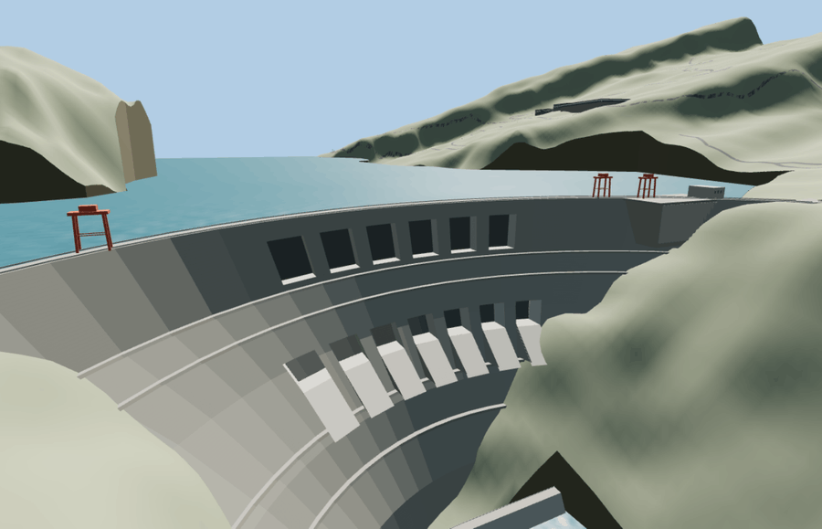

# Baihetan Dam

The model reproduces the 709 m asymmetric double-curvature arch, six surface spillway bays, seven deep outlets with chutes, crest galleries, red gantries, finned intake, concrete abutment ties and the auxiliary weir.

The signed placement fixes the 709 m arch crest at 834 m. The Earth viewer renders the 825 m reservoir and 638.62 m tailwater. The building cutout suppresses only the mapped duplicate dam volume, exposing the six upper and seven deep outlets. All five neighboring building features and 84 road records remain available. Buried waterway lines are hidden.

The Earth fixture retains all three mapped service road records. The ground opening follows the upper central arch. Failed loading preserves the native layers. Eviction restores the ground and releases model geometry.

| Detail level | Triangles | Download bytes | Draws |
| --- | ---: | ---: | ---: |
| skyline | 758 | 63,028 | 5 |
| district | 1,434 | 112,104 | 6 |
| street | 2,654 | 199,604 | 6 |
| closeup | 2,774 | 208,964 | 6 |

Skyline and district total 175,132 bytes. Six GLBs pass Khronos validation and contain zero embedded images. Five shared material graphs bind in the viewer. The review covers 71 renders and 135 geographic samples.

The reservoir and tailwater stages are representative. The plunge pool level is shown in the local lighting fixture. The native fixture preserves the mapped tailwater and the modeled auxiliary weir. The coarse Terrarium slopes leave angular shoreline sections and obscure parts of the outer abutments.

The host supplies the corresponding Protomaps features and terrain samples fine enough to resolve the local tailrace grades. The asset shows static exterior structures.

[Mapped site frame](map-frame.json) · [Terrain and water fit](site-fit.json) · [QA evidence](qa.json)
