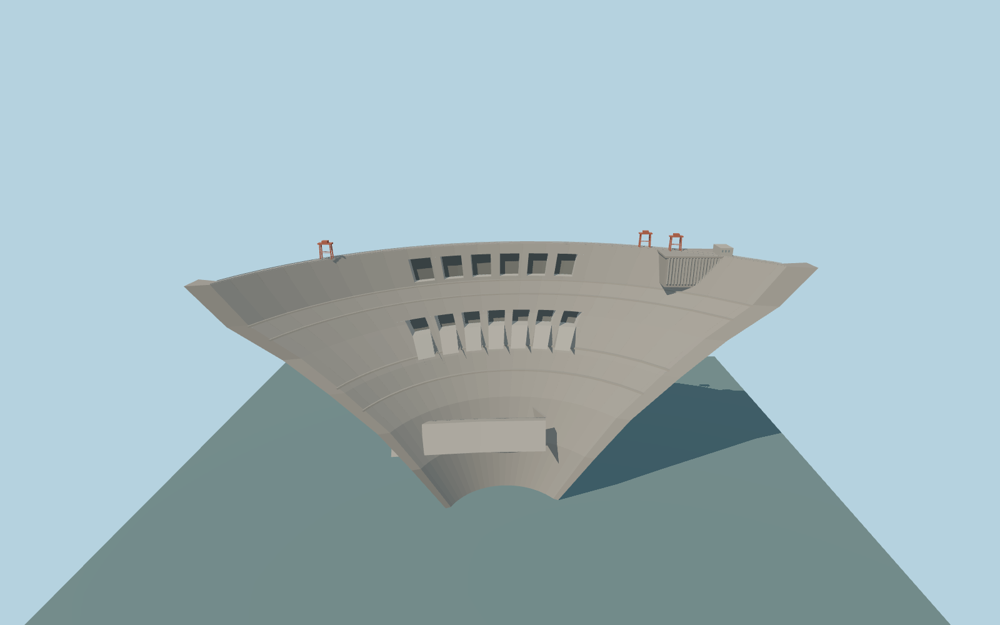

# Baihetan Dam

Baihetan Dam’s 709 m double-curvature arch crest, six surface bays, seven deep outlets, red gantries and finned intake, plus the plunge pool retaining walls and downstream auxiliary weir.

Rebuild: `node packages/worldgen/scripts/generate-baihetan-dam.mjs`;append `--check` for exact source bytes. Select import/LOD/placement with `--ids=baihetan_dam`. Detailed source and four browser tiers are separate ignored GLB outputs.

The absolute vertical origin is 644.781 m and the concrete crest is fixed at 834 m. The operator’s normal reservoir level is 825 m. The production water sampler gives 676.79 m upstream and 637.62–641.76 m downstream on the checked normal tile boundaries.

The source geometry reproduces the documented arch length and elevation with measured map alignment. The subsurface section, abutment reinforcement, exterior gate settings, and the modeled 650 m weir crest and 643 m plunge stage are approximate.

The sampled reservoir sits about 148 m below the normal pool. This exposes the upstream face and creates steep bank curtains in the standard viewer comparison. The operator’s normal pool is used in a separate review fixture.

The buried generation caverns and spillway tunnels are represented by their retained map lines for placement. Interiors, tunnel sections, and operating discharges are outside this exterior asset.

Original geometry:repository license. Map:© OpenStreetMap contributors,ODbL-1.0;Protomaps. Standard terrain:terrain-grid.json. Ordinary pictures stay local and are not redistributed or used as textures. Current acceptance:qa.json.
