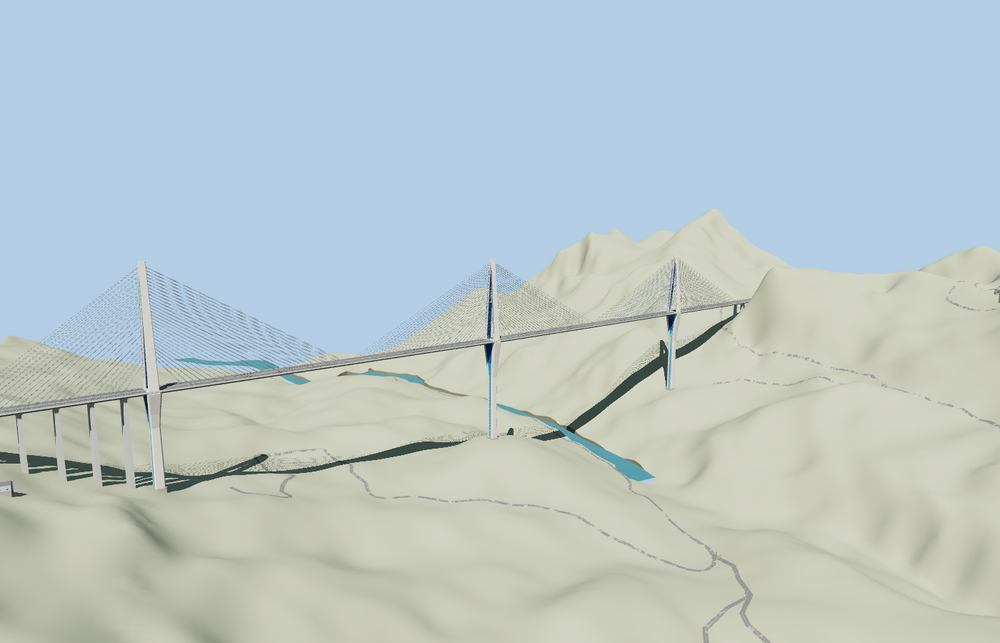

# Pingtang Bridge

Pingtang Bridge with three white-and-blue split-head pylons, paired cable planes, a 2.1 km divided deck, the approach trestles and the two southwest S62 tunnel mouths.

The 36,498-triangle source rebuilds byte for byte. Skyline, district, street and close-up use 1,000, 3,890, 7,934, 29,042 triangles. The first two tiers total 351,808 bytes. Six GLBs validated and 38 current views were inspected.

The native viewer preserves both mapped tunnels, the river and 6 neighboring buildings. Each LOD passes three pylon contacts, six tunnel-clearance probes, six northeast lane-width joins and eight approach-grade probes. The largest sampled join difference is 0.039 m. Failed loading restores the standard bridge and closes the local terrain opening.

Pylon stations follow visible aerial base and shadow traces. Pylon leg profiles, stay counts and roadway fittings are photo-based approximations. The exterior model includes both tunnel mouths and 20 m of recessed lining capped in shadow. The native S62 tunnel paths continue below terrain. A local opening fits only the portal mouths to the coarse hill. The current map gives the carriageway endpoints and a 2,124.51 m axis envelope. The retained 1,116.03 m bridge polygon is partial. The 2,135 m reference length is recorded separately. Physical-device timings are unmeasured.

Rebuild with `node packages/worldgen/scripts/generate-pingtang-bridge.mjs`. Append `--check` to compare exact bytes. Use `--ids=pingtang_bridge` for targeted import, LOD, placement and readiness.
