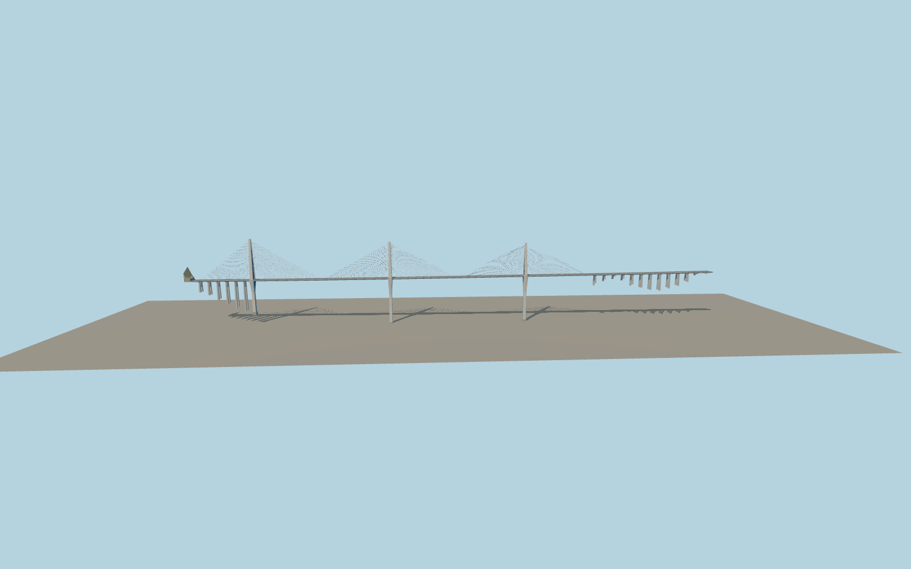

# Pingtang Bridge

Pingtang Bridge with three white-and-blue split-head pylons, paired cable planes, a 2.1 km divided deck, the approach trestles and the two southwest S62 tunnel mouths.

Run `node packages/worldgen/scripts/generate-pingtang-bridge.mjs` to rebuild the source master. Append `--check` to compare the exact bytes. Use `--ids=pingtang_bridge` for targeted import, LOD generation and placement.

Pylon stations follow visible aerial base and shadow traces. Pylon leg profiles, stay counts and roadway fittings are photo-based approximations.

The exterior model includes both tunnel mouths and 20 m of recessed lining capped in shadow. The native S62 tunnel paths continue below terrain. A local opening fits only the portal mouths to the coarse hill.

The current map gives the carriageway endpoints and a 2,124.51 m axis envelope. The retained 1,116.03 m bridge polygon is partial. The 2,135 m reference length is recorded separately.

Original geometry follows the repository license. Map data is © OpenStreetMap contributors under ODbL-1.0 via Protomaps. Terrain samples are described in terrain-grid.json. Ordinary pictures stay local and are not redistributed or used as textures. Current acceptance:qa.json.
