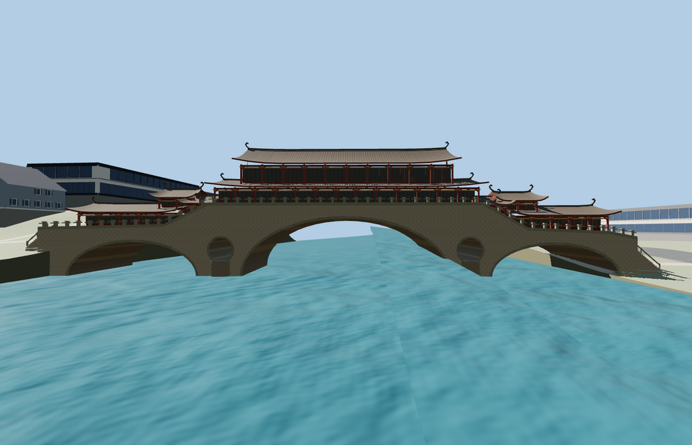

# Anshun Bridge

Three stone vaults and two pier oculi carry a raised timber gallery. Dark sweeping roofs crown the red columns and stepped side pavilions. Pale railings follow the two walkways from the stair landings to the central hall.

The 51,236-triangle source rebuilds byte for byte. Skyline, district, street and close-up use 716, 3,576, 15,344, 39,984 triangles. Skyline and district total 357,012 bytes. Six GLBs validated and 36 current views were inspected.

All four tiers preserve the three open arches, two through oculi and both pier contacts below the rendered water. Eighteen deck samples and four landing seams pass at every detail level. The largest landing difference is 0.07 m. A scoped paving cutout clears the draped pedestrian area in the channel. The viewer retains 55 independent buildings and 27 transportation records. Failed loading restores both procedural crossings and their deck area.

PMTiles fixes the crossing, deck footprint and four mapped approach branches. Arch proportions, roof sweeps, raised gallery heights and stair grades are exterior estimates. The standard elevation grid smooths bank walls and does not resolve exact water levels or individual steps. The model represents exterior geometry and omits the restaurant interior.

Rebuild with `node packages/worldgen/scripts/generate-anshun-bridge.mjs`. Append `--check` to compare exact bytes. Use `--ids=anshun_bridge` for targeted import, LOD, placement and readiness.
