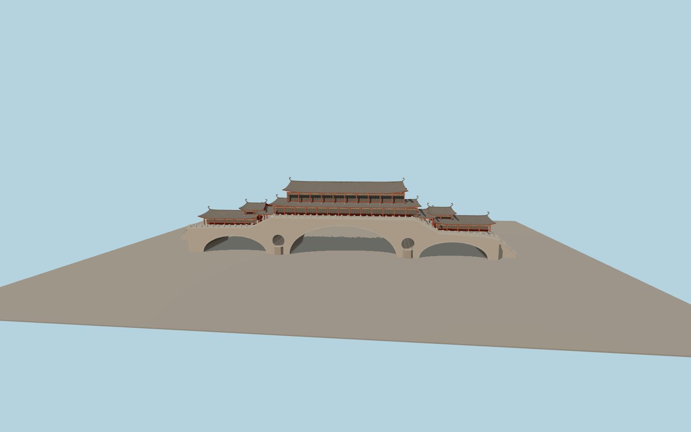

# Anshun Bridge

Three stone vaults and two pier oculi carry a raised timber gallery. Dark sweeping roofs crown the red columns and stepped side pavilions. Pale railings follow the two walkways from the stair landings to the central hall.

Run `node packages/worldgen/scripts/generate-vushtrri-stone-bridge.mjs` to rebuild the source master. Append `--check` to compare the exact bytes. Use `--ids=anshun_bridge` for targeted import, LOD generation and placement.

PMTiles fixes the crossing, deck footprint and four mapped approach branches. Arch proportions, roof sweeps, raised gallery heights and stair grades are exterior estimates.

The standard elevation grid smooths bank walls and does not resolve exact water levels or individual steps. The model represents exterior geometry and omits the restaurant interior.

Original geometry follows the repository license. Map data is © OpenStreetMap contributors under ODbL-1.0 via Protomaps. Terrain samples are described in terrain-grid.json. Ordinary pictures stay local and are not redistributed or used as textures. Current acceptance is recorded in qa.json.
