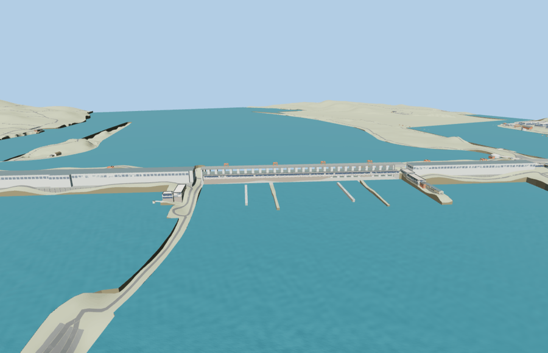

# Gezhouba Dam

The 2.6065 km crossing has 27 main spillway bays, nine western silt sluices, six eastern silt sluices, two separately outlined powerhouse wings, red traveling gantries and three distinct locks.

The Earth viewer holds the Yangtze at 66 m upstream and 39 m downstream. The three authored lock chambers retain distinct illustrative surfaces at 48, 49 and 45 m. Local grading repairs invalid elevations near the forebay and lower banks. The placement replaces the native record covering both powerhouse wings, preserves the other 236 building records, and leaves all 372 road records in the focused fixture.

Failed loading preserves the native layers. Eviction restores the ground and releases model geometry.

| Detail level | Triangles | Download bytes | Draws |
| --- | ---: | ---: | ---: |
| skyline | 980 | 83,616 | 6 |
| district | 2,996 | 240,296 | 6 |
| street | 9,400 | 739,844 | 6 |
| closeup | 10,912 | 857,784 | 6 |

Skyline and district total 323,912 bytes. Six GLBs pass Khronos validation and contain zero embedded images. Five shared material graphs bind in the viewer. The review covers 64 renders and 75 geographic samples.

The water levels represent static conditions. The standard terrain approximates the bank and abutment shapes. Equipment spacing and approach grades are estimates.

The model represents the principal crossing and the three mapped navigation chambers. Lock 3 is the closed legacy chamber. Temporary cofferdams, current expansion work and operating discharge are outside the modeled scope.

[Mapped site frame](map-frame.json) · [Terrain and water fit](site-fit.json) · [QA evidence](qa.json)
