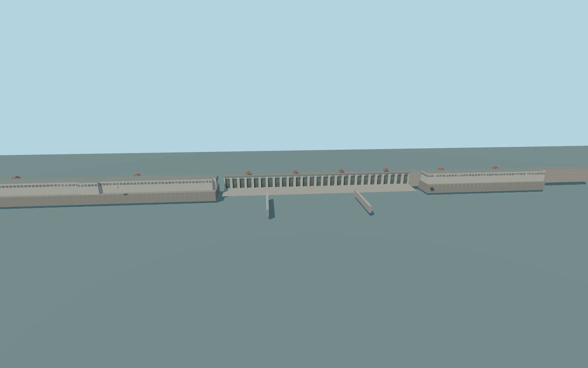

# Gezhouba Dam

Gezhouba Dam’s 2,606.5 m Yangtze crossing with 42 gates in three groups, two mapped powerhouse wings, red traveling gantries, and three separately oriented ship locks.

Rebuild: `node packages/worldgen/scripts/generate-gezhouba-dam.mjs`;append `--check` for exact source bytes. Select import/LOD/placement with `--ids=gezhouba_dam`. Detailed source and four browser tiers are separate ignored GLB outputs.

The signed vertical origin is 62.58556 m. The crest is fixed at 70 m. The design fixture uses a 66 m headwater and a 39 m navigable tailwater; lock chamber stages are illustrative.

The powerhouse footprints and lock axes follow PMTiles. Approach ties, exposed wall heights, equipment spacing and exterior dimensions without mapped controls are approximations.

Representative standard terrain gives 62.62 m upstream and 42.78 m downstream. The design water fixture is reviewed independently of the terrain-derived viewer stages.

Lock 3 depicts the mapped legacy chamber with closed gates. The active expansion and temporary cofferdams are outside this exterior asset.

Original geometry:repository license. Map:© OpenStreetMap contributors,ODbL-1.0;Protomaps. Standard terrain:terrain-grid.json. Ordinary pictures stay local and are not redistributed or used as textures. Current acceptance:qa.json.
