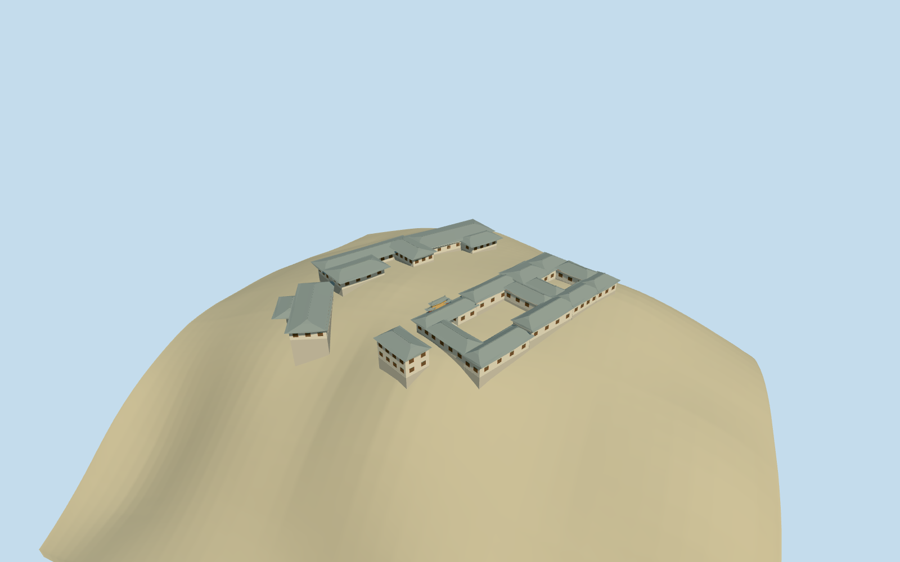

# Baidicheng

Specific Baidicheng core: eight named mapped hall/temple footprints articulated into gray swept tile roof ranges, open main/eastern courts, a taller White House, northern U/L exhibition ranges and an ochre/red decorated Baidi gateway with a real rounded arch, triple roof crests, original simplified painted-panel/scroll vocabulary, stairs and two simplified stone guardians. Island landform, trees, shoreline, bridge, external paths and independent buildings remain host context. No complete ancient fortress restoration, copied text/narrative painting or museum interior.

## Evidence and reconstruction

Published dimensions and reconstructed details are separated in spec.json. Primary references:

- [Reference](https://commons.wikimedia.org/wiki/File:Baidicheng_2014.jpg)
- [Reference](https://www.xinhuanet.com/english/2019-12/23/c_138652333.htm)

A deterministic site recipe and reusable swept hip-roof helper articulate eight actual Baidicheng core envelopes into twenty roof ranges, open main/eastern courts, White House and the decorated rounded-arch gateway. Four existing shared256-square plaster/wood/tile/raw-stone graphs, metric UVs, linear tints and four browser levels; no embedded images or copied painting/text.

## Model and axes

9,446 triangles; 28,338 vertices; 6 material groups; 1,137,388 bytes. Native bounds: -68.066, -17.813, -59.052 to 59.238, 10.796, 70.612. Source hash: `sha256:5f9a552e7b12692a53284d5b8fab54455c1f75a70caac07a12c743b2fc594c80`.

{"x":"east","y":"up","z":"south"}

The geographic proposal uses exact-QID OpenStreetMap evidence. Map-derived orientation and estimated architectural details require real-site visual review; preview eligibility is distinct from geographic/fidelity approval. Map attribution: © OpenStreetMap contributors, ODbL-1.0.

## Reproduce

Run `node packages/worldgen/scripts/generate-additional-landmarks.mjs --ids=baidicheng` (or add `--check`). The generator preserves manually edited masters by checking their baseline hashes. Import through the standard authored-model workflow with optimization disabled; then capture all QA cameras, including shared-surface views.

## Pending work

- Specific Baidicheng core: eight named mapped hall/temple footprints articulated into gray swept tile roof ranges, open main/eastern courts, a taller White House, northern U/L exhibition ranges and an ochre/red decorated Baidi gateway with a real rounded arch, triple roof crests, original simplified painted-panel/scroll vocabulary, stairs and two simplified stone guardians. Island landform, trees, shoreline, bridge, external paths and independent buildings remain host context. No complete ancient fortress restoration, copied text/narrative painting or museum interior.
- Named standard PMTiles Baidi Castle node2411108613 lies about10m from the candidate coordinate. Eight named building/POI controls35185207107684 through35185207107691 fix the core envelopes: Bright Goodness Hall, Baidi Temple, Eight Tactical Arrays Hall, Crusade Against Wu Hall, Suspending Coffin Hall, Ten Wistom Hall (map spelling), Cultural Relics Showroom and White House. Root heading0, internal angle+.412rad from native east toward south. Roof/court splits and the gateway on the north edge of the main Baidi envelope are explicit picture/map-led allocations, not surveyed interior plans or an exact-QID footprint claim.
- Picture-led one-story hall bodies about4.2m with swept gray roofs rising2.5m, some larger halls4.8m/3m roof rise; White House about7m body/2.6m roof. Decorated gateway about8.2m and4m arch crown above its local threshold. Eight horizontal envelopes come from standard map; individual roof splits, gallery facades, levels, internal courts, gate location and sculptural inventory remain exterior approximations.
- Retain original standard6m Mapzen hill terrain and water. Each hall/roof section has a separate local level floor with grade-buried base edges. Main/eastern courts and central garden remain open native ground, without a broad flattened island platform or ground/water cutout. Short gateway stairs/threshold connect to sampled local grade. Wooded coarse DEM does not resolve individual terrace levels, paving, covered passages, shoreline reservoir elevations or thresholds.
- Twenty roof splits, court openings, gateway assignment/facing, facades, heights, guardian pair and painted relief are ordinary-picture/map approximations. No copied readable text/narrative mural, complete interiors or ancient fortress restoration. Island landscape, bridge, shoreline and independent buildings remain host context.

This bundle follows the medium-fi standard. Medium-fi appearance and geographic fit are reviewed separately. Hash-bound visual acceptance is recorded separately after capture inspection.

## Additional geographic data

©OpenStreetMap contributors; Protomaps; Mapzen/USGS terrain.
