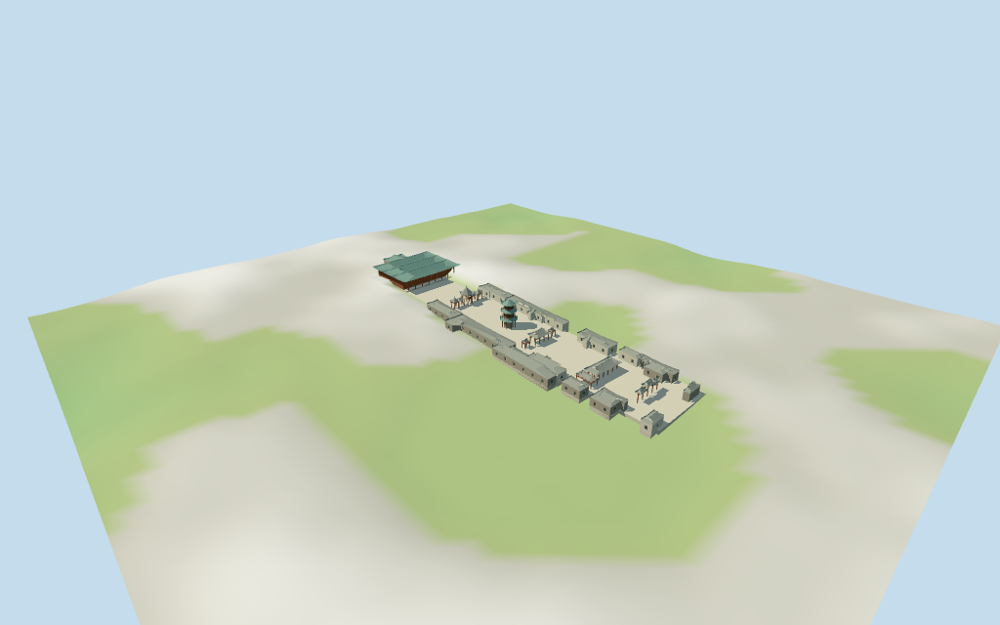

# Great Mosque of Xi'an

Individual medium-fi Great Mosque of Xi'an compound with mapped T-shaped western prayer hall/three conjoined green roofs and open red-column portico,open multi-roof Phoenix Pavilion,three-eave octagonal central tower/arched base,axial gateways/estimated timber paifang,courtyard-bordering wings,small stele shelters and open paved courts.21 retained current building controls;functional identities,boundary,unmapped roofs/portals,heights and fine details are explicit picture/layout estimates. Six shared graphs,seven merged roles,four browser levels. Exact sculpture,calligraphy,planting,interiors,current finish and ground joins remain limited.

## Evidence and reconstruction

Published dimensions and reconstructed details are separated in spec.json. Primary references:

- [Reference](https://commons.wikimedia.org/wiki/File:Xi'an_Great_Mosque_prayer_hall.jpg)
- [Reference](https://commons.wikimedia.org/wiki/File:Great_Mosque_of_Xi%27an_(29)_-_Phoenix_Pavilion_(50464839741).jpg)
- [Reference](https://commons.wikimedia.org/wiki/File:Chinese-style_minaret_of_the_Great_Mosque_2023.jpg)

Six existing shared256² brick,lime plaster,continuous limestone,plain wood,barrel ceramic and glazed tile graphs;seven roles including local opaque glazing. Painted timber and green roofs use shared texture/tint variants. Metric UVs,linear tints,faceted architecture;no embedded images,unique facade atlas,copied calligraphy or baked lighting.

## Model and axes

22,408 triangles; 67,224 vertices; 7 material groups; 2,693,160 bytes. Native bounds: -115.490, -1.745, -25.200 to 109.000, 17.581, 31.314. Source hash: `sha256:1237e6fe21683bd35c8c8ef537c8552002f0252b7dd6c301088cace2a557e0b4`.

{"x":"east entrances;negative west prayer hall","y":"up","z":"south side wings"}

Standard viewer DEM datum 409.30188030076687m. Floor 0.5808836509701223m is median of 394 outside-perimeter samples every2m at1m offset plus0.25m. Raw selected-compound range -1.422880300766849..4.775619699233118m. Model-visible cutout and preview seating follow the estimated union boundary;the raw161² grid is retained. This is a level visualization court plane,not measured paving/threshold elevation. Exact road,entry-step,perimeter-wall and street joins remain unverified.

## Reproduce

Run `node packages/worldgen/scripts/generate-additional-landmarks.mjs --ids=N0449` (or add `--check`). The generator preserves manually edited masters by checking their baseline hashes. Import through the standard authored-model workflow with optimization disabled; then capture all QA cameras, including shared-surface views.

## Pending work

- The retained Q820842 reference has no resolved exact-QID footprint. Current standard viewer POI35184817098844 is named 清真大寺 /The Great Mosque of Xi'an in multiple languages and lies11.84m west of the retained reference anchor[108.936655788,34.263385616]. The nearby western T-shaped prayer hall,hexagonal Phoenix Pavilion footprint,central polygonal tower,eastern gates and courtyard-bordering ranges provide21 current building controls /131 raw points. The individual controls are retained exactly;functional naming and compound membership are picture/map-layout interpretations,not new exact-QID tags. PositiveX east toward entrances,negativeX west prayer hall,positiveZ south;heading0rad follows the map's east-west plan. No horizontal rescale. The compound paving/cutout is an estimated courtyard strip[-72,-16,109,22] union the selected footprints,not a surveyed parcel. Separate surrounding town buildings and other named mosques remain host content.
- Retained width48m and length246m facts have no linked reference URLs;they are nominal whole-site facts,not controls for stretching current individual map footprints. No retained height or selected map height/min_height tags. All vertical/internal values are picture estimates:side wings4.4m eaves/6.2m ridge,three conjoined prayer-hall roofs7.8m eaves/11.2m ridge,raised prayer portico0.8m,central three-eave tower17.0m including finial,Phoenix Pavilion central roof11.8m/side caps7.7m,mapped gate roofs6.6m and unmapped timber gateway8m. Main hall partitions,unmapped pavilion wings,roof curvature,brackets,railing/bay counts and gateway/stela forms are approximations. Tower minaret function is not independently established. Exact current finish,inscriptions,small sculpture,interiors and ground/approach joins remain unverified.
- Standard viewer DEM datum 409.30188030076687m. Floor 0.5808836509701223m is median of 394 outside-perimeter samples every2m at1m offset plus0.25m. Raw selected-compound range -1.422880300766849..4.775619699233118m. Model-visible cutout and preview seating follow the estimated union boundary;the raw161² grid is retained. This is a level visualization court plane,not measured paving/threshold elevation. Exact road,entry-step,perimeter-wall and street joins remain unverified.
- Three inspected pictures and normal viewer PMTiles/DEM guide the individual compound.21 current footprints retained;no exact-QID polygon resolved. Functional labels,membership,paving boundary,unmapped Phoenix wings/paifang,roof/room partitions and all heights are reviewed estimates. Grey/red timber and green/grey curved tile roofs distinguish the Chinese exterior;fine dougong,roof-end sculpture,plaques,calligraphy,planting and precise lattice/bay counts remain abstracted or omitted. The central tower has an open base passage;upper screens and prayer doors close opaque exterior fields. No furnished or freely traversable interior. Current finish,exact ground/step/street joins,engineering and physical-device measurements remain unverified. Surrounding town buildings and other mosques are excluded;synthetic East Asian neighbors are fixtures.

This bundle follows the medium-fi standard. Medium-fi appearance and geographic fit are reviewed separately. Hash-bound visual acceptance is recorded separately after capture inspection.

## Additional geographic data

©OpenStreetMap contributors;Protomaps;Mapzen/USGS terrain tiles.
