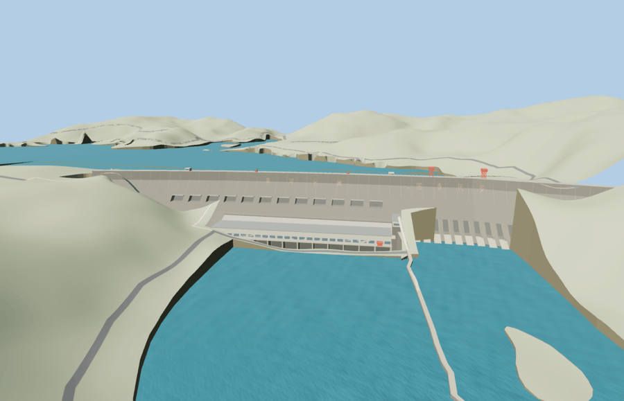

# Sanmenxia Dam

The model follows the 713 m bowed main dam and includes the 12 upper west outlets, 12 lower east outlets and spillway aprons, two red crest gantries, the photographed inscriptions, the powerhouse and sloped service apron, and the mapped downstream divider.

The Earth viewer holds the reservoir at 316.96 m and the tailwater at 281.57 m. The local shoreline joins the mapped tailwater around the concrete divider, and local grades blend the west abutment, lower the submerged channel beside the divider, and repair invalid terrain near the forebay. The model replaces the mapped powerhouse footprint and retains the other thirteen local buildings and all fifty road records, including the separate downstream bridge.

Failed loading preserves the native layers. Eviction restores the ground and releases model geometry.

| Detail level | Triangles | Download bytes | Draws |
| --- | ---: | ---: | ---: |
| skyline | 962 | 88,036 | 1 |
| district | 2,002 | 183,872 | 6 |
| street | 2,936 | 272,756 | 7 |
| closeup | 3,704 | 339,284 | 7 |

Skyline and district total 271,908 bytes. Six GLBs pass Khronos validation and contain zero embedded images. Six shared material graphs bind in the viewer. The review covers 78 renders and 115 geographic samples.

Water stages represent the retained map and terrain samples. Coarse terrain limits the precision of the banks and abutment contacts.

The original exterior covers the main dam, divider and generating hall. Auxiliary earthworks, buried tunnels and operating discharge are outside the modeled area.

[Mapped site frame](map-frame.json) · [Terrain and water fit](site-fit.json) · [QA evidence](qa.json)
