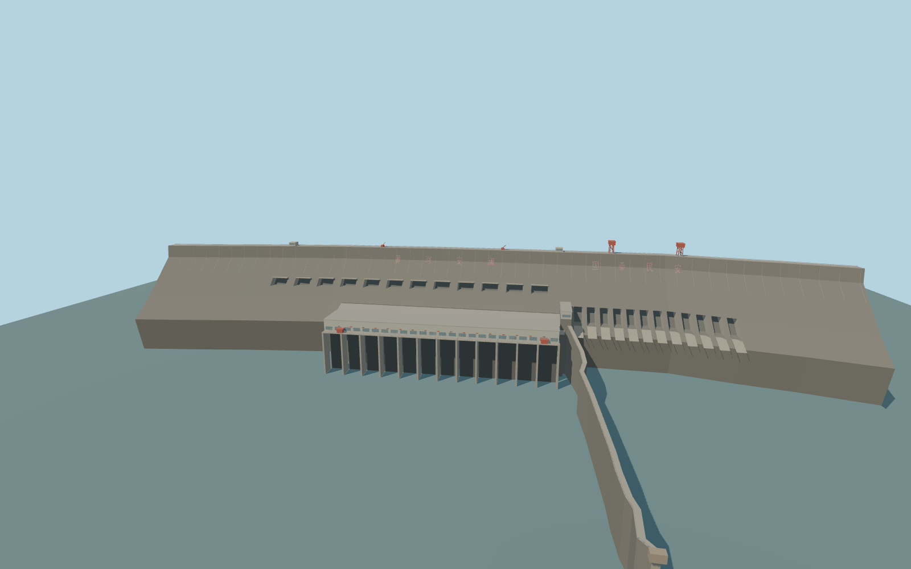

# Sanmenxia Dam

Sanmenxia’s 713.2 m main gravity dam, two rows of outlet works, the mapped generating hall, downstream divider, red crest gantries and immediate bank ties.

Rebuild: `node packages/worldgen/scripts/generate-sanmenxia-dam.mjs`;append `--check` for exact source bytes. Select import/LOD/placement with `--ids=sanmenxia_dam`. Detailed source and four browser tiers are separate ignored GLB outputs.

The documented crest is 353 m. The terrain reference is 330.28 m. The standard terrain sampler gives 316.07–316.96 m in the reservoir and 275.83–281.57 m downstream, with 281.57 m at the generating hall and spillway.

The main dam, external outlet faces and generating hall follow the photographed arrangement. Recess dimensions, operating gate states and local terraces are exterior interpretations.

The separately described auxiliary embankment and buried outlet tunnels are outside the retained map scope. The separate downstream crossing and neighboring buildings remain native.

Nineteen raw terrain samples near the modeled dam are below sea level. The source field is retained unchanged. The two visible inscriptions are original modeled lettering using the photographed wording.

Original geometry:repository license. Map:© OpenStreetMap contributors,ODbL-1.0;Protomaps. Standard terrain:terrain-grid.json. Ordinary pictures stay local and are not redistributed or used as textures. Current acceptance:qa.json.
