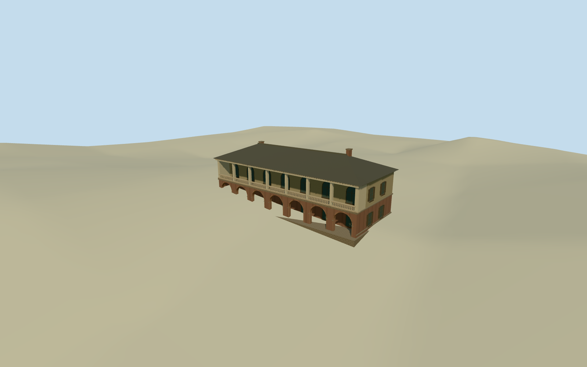

# The Canton Hospital

The late nineteenth-century arcade and veranda of Canton Hospital, with the broad tiled roof shown in the November 1895 photograph.

Authoring state: **review-in-qa.json**. Current completion evidence is in [qa.json](qa.json) and the [completion ledger](../../../../qualla-structures/batches/qualla-004.PROGRESS.md).

- [The Canton Hospital](https://qualla.com/the-canton-hospital/)

The model depicts the single wing shown in the 1895 photograph. It covers an earlier phase than the twentieth-century campus and later design published with the story.

The photographed front scale uses people, arch spacing and floor height. Behind-tree bays, the back, width and pitch of the roof, window schedules, material colors and block position are approximations. The independent mapped boundary represents the successor campus.

Modern urban structures influence the source DSM. The archival evidence does not establish the courtyard’s historic height.

Build: `node content/worldgen/source/places/ws/ws0/canton_hospital/models/generate-canton-hospital.mjs`. Add `--check` to verify exact regeneration. 12106 triangles; 6 materials; no embedded photographs.
