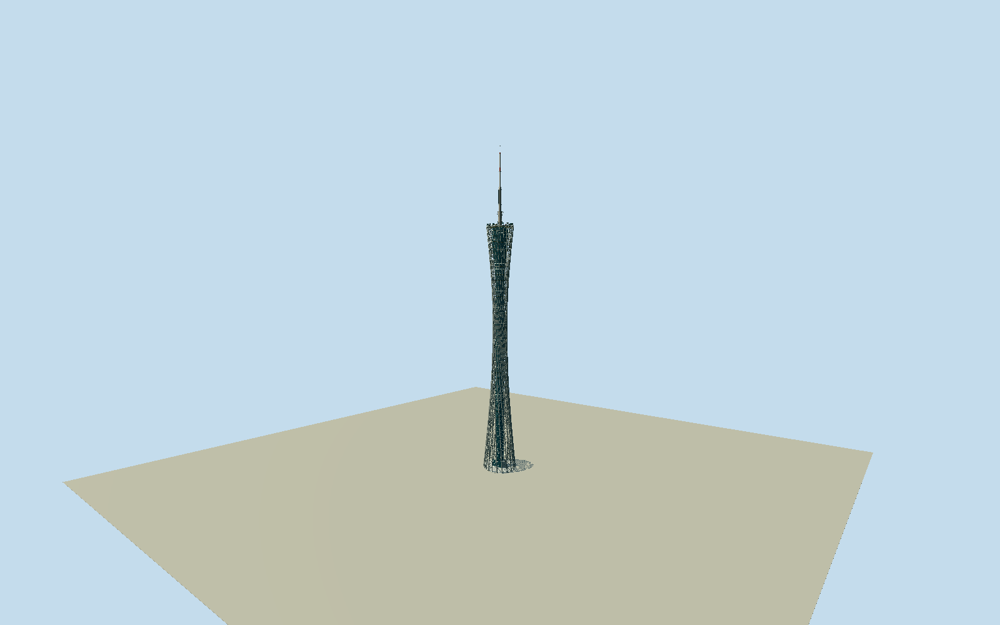

# Canton Tower

Whole600m Canton Tower: exact native26control intrinsic base, open24-column inclined pale steel lattice with46 horizontal rings/diagonals, twisting narrow waist and flared upper basket, opaque blue-grey inner core/public-level banks, top observation roof/rail and complete150m segmented antenna with pale/red upper aerial. Original recessed base entrance and hidden member/base/roof-service details are bounded photographic estimates. No similarly named stations, plaza/property slab, neighboring buildings, temporary festival installations, people, signs or interiors.

Authoring state: **review-in-qa.json**. Current completion evidence is in [qa.json](qa.json) and the [completion ledger](../../../../qualla-structures/batches/qualla-002.PROGRESS.md).

- [Canton Tower](https://qualla.com/canton-tower/)

Exact named tower way584204634/Q168400,26unique original base controls; similarly named Canton Tower stations/Q5097203 are different structures and excluded. Native bbox midpoint/+Xeast/+Zsouth/heading0. Original mapped base ring retained; architecturally twisted open steel tower must never become a solid extruded oval. Heights/sections/member census chosen only after independent field freeze.

Original400m129x12916641sample field and two raw tiles frozen before these sections/all geometry; fixed SW provider datum-1.1728m/modelY0. Architectural floor0 is an original unsurveyed estimate, never fitted to subsequent ground renders. Municipal text gives600m=450m body+150m antenna,24 columns/46 rings and135degree relative ellipse rotation. Native26control base retained; top ellipse55x41m/core14x17m/member diameters, internal public-level banks, antenna staging/base entry and hidden finish/census are bounded original photographic proportions, not certified dimensions. Native base is a building envelope, not a plaza/property extrusion. No ground flattening/refitting/reacquisition or later model raising; foundation contact remains preview/unresolved.

One exact already published2011 Brücke-Osteuropa CC0/own original, personally inspected and nativeSHA1 matched after Qualla-first47family scan. Early construction/model photograph unselected. No supplemental images, questionable sources, copied pixels, generated bitmaps or article/media/rightsmetadata repairs. Historic2011 exterior informs standing architecture; hidden base/current finish/public-level heights/census/member sections/service caps are original bounded estimates, not structural drawings or a current survey.

Independent400m129x12916641sample field/two original tiles frozen before floors/sections/geometry; unchanged SW provider datum-1.1728m. Field includes urban/river artifacts and an extreme negative elevation anomaly; no fit/flatten/reacquire/model raising. Floor0 is unsurveyed; exact foundations/grade unresolved and placement remains preview/replaceFootprint=false. Portable and neighborhood ground are synthetic fixtures, not geographic evidence.

Build: `node content/worldgen/source/places/ws/ws0/canton_tower/models/generate-canton-tower.mjs`. Add `--check` to verify exact regeneration. 62462 triangles; 4 materials; no embedded photographs.
