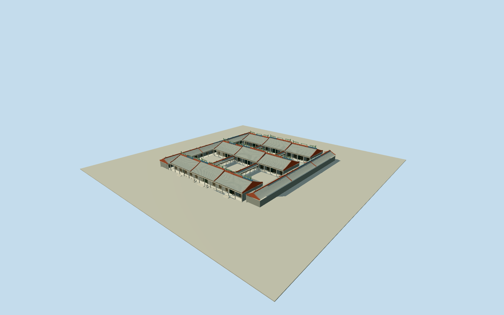

# Chen Clan Ancestral Hall

Complete native museum/5roofed-range compound: three successive transverse hall ranges/long side wings, open courts and inferred low covered links, nineteen articulated Lingnan gable/roof volumes, grey rolled tile courses, red raised firewalls, genuinely pierced multi-tier ceramic ridge/pavilion/robed-figure/fish ornament, stone colonnades/carved brackets, dark timber screens/plaque, intrinsic platforms/steps/pierced rails and entrance guardians. No metro station, modern museum collections, square/streets or landscape. Native parent outlines retained; roof subdivisions, concealed elevations/layout and fine sculpture are bounded photographic estimates.

Authoring state: **review-in-qa.json**. Current completion evidence is in [qa.json](qa.json) and the [completion ledger](../../../../qualla-structures/batches/qualla-002.PROGRESS.md).

- [Chen Clan Ancestral Hall](https://qualla.com/chen-clan-ancestral-hall/)

Original named museumway520935699/Q5090739supplies its4corner87.45x97.8mbounded site; all4corners of each of5roofed-buildingways682114503–682114507are retained separately. These establish three successive roughly60x17mtransverse ranges and two narrow roughly9x82mlong side wings. The enclosure is NOT a solid building footprint. Underground metrostation/Q5090740, adjacent square and modern buildings are excluded. Native outlines do not survey the19historical building subdivisions/nine halls/six courtyards: subdivisions and four low inner connecting walks are photo/text-inferred topology within these controls, not newly measured native footprints. The broader13,200m2story figure is not used to stretch or replace this native bounded complex. Roof/elevation/ornament/grade details remain photographic estimates.

All5original roofed-range outlines are preserved independently inside the named museum enclosure. Nine transverse-range gables, six long-wing roof segments and four low covered links are a bounded photo/text-inferred topology for the nine halls/six courts; they are not separately surveyed19historic building footprints. No enclosure-sized solid block or filled courts, and no similarly named underground metrostation.

Main eaves5.4m/ridges8.65–9.55m/ceramic crowns roughly11.6m, wing eaves4.6m/ridges6.8m, low-walk eaves3.6m/ridges4.7m and intrinsic.65mplatforms are photographic estimates. Exact internal room divisions, hidden roofs/rear elevations, individual roof extents and grade/contact remain unverified.

Four exact QuallaZyng1PublicDomainarchitectural originals were inspected first, then same-creatorPD-self450x260overall front for broad composition and four explicit self|cc-zero2019courtyard/hall/corridor originals by神樂坂秀吉. Native hashes/revision/dedications are saved; all9selected originals inspected. No other image, museum screen-door/collection material, modern exhibit or photographic texture.

Grey paired cylindrical tile rolls/rounded eave ends, raised red hard-gable walls, open stone/timber colonnades and pierced ceramic tableaux/pavilion/robed-figure/fish crests are genuine geometry. Fine portraits/drama identities, particular relief scenes, complete ridge sculptural census, calligraphy fonts, erosion/individual tile joints and detailed interior objects are bounded original medium-fi approximations. Entrance plaque uses original geometric strokes for the observed right-to-left陳氏書院; no image glyph texture.

Roof tile cover rolls are grouped at roughly.65mclose-detail pitch rather than every ancient tile; paired roll/gutter rhythm and rounded eave silhouettes are retained. Fine rolled tiles/robed figures/lattice, capital and brick relief, pierced rail inserts and lettering retire progressively at distance.

Only intrinsic native floors/platforms, low walk floors, three short entrance flights, rails and guardians are included. Trees/planting/visitors/lantern decor, museum exhibits/furnishings, utility wires/flags/cameras/bins, modern neighboring buildings and adjacent square/roads excluded. Fixed front point[0,53]precedes terrain sampling; source relief is retained without a whole-site slab, and exact footing/threshold/host-terrain contact remains unverified.

Build: `node packages/worldgen/scripts/generate-authored-places.mjs --ids=chen_clan_ancestral_hall`. Add `--check` to verify exact regeneration. 62681 triangles; 5 materials; no embedded photographs.
