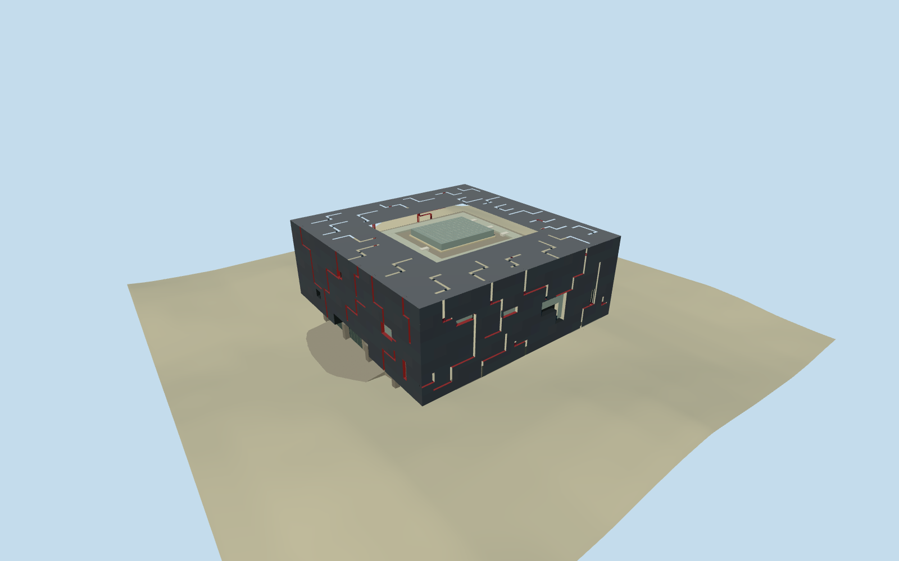

# Guangdong Museum

A charcoal exhibition box with carved red-lined voids, a broad recessed atrium roof and an elevated west entrance.

Authoring state: **review-in-qa.json**. Current completion evidence is in [qa.json](qa.json) and the [completion ledger](../../../../qualla-structures/batches/qualla-004.PROGRESS.md).

- [Guangdong Museum](https://qualla.com/guangdong-museum/)

The roof and the south and west elevations draw directly from the cleared aerial perspective. Pattern dimensions, glazing divisions and recessed depths are approximate, particularly on the north and east faces.

The source grade is reproduced at provider resolution. The entry deck and planted verge are simplified architectural geometry. Interior exhibits and adjacent buildings are outside the model scope.

Build: `node content/worldgen/source/places/ws/ws0/guangdong_museum/models/generate-guangdong-museum.mjs`. Add `--check` to verify exact regeneration. 33842 triangles; 5 materials; no embedded photographs.
