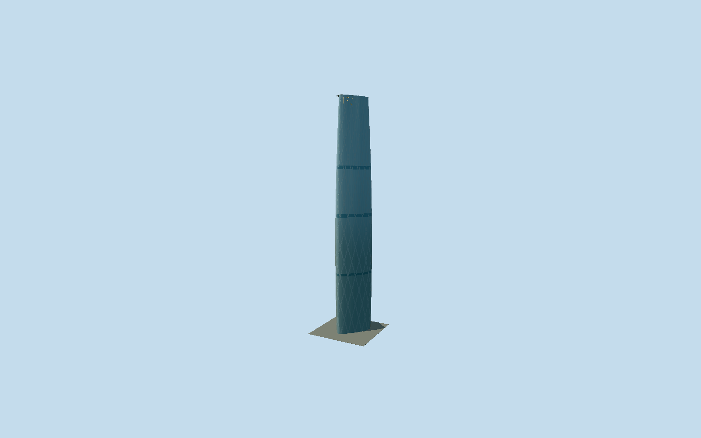

# Guangzhou International Finance Center

Guangzhou’s curved triangular blue-glass West Tower, gently swelling shaft, subtle diagrid and three dark mechanical bands, triangular roof skylight and west-offset raised circular helipad.

## Evidence and reconstruction

Published dimensions and reconstructed details are separated in spec.json. Primary references:

- [Reference](https://wilkinsoneyre.com/projects/guangzhou-international-finance-center)
- [Reference](https://www.skyscrapercenter.com/building/guangzhou-international-finance-center/174)
- [Reference](https://global.ctbuh.org/resources/papers/download/3310-engineering-of-guangzhou-international-finance-centre.pdf)
- [Reference](https://www.researchgate.net/publication/316893174_Engineering_of_Guangzhou_International_Finance_Centre)
- [Reference](https://www.openstreetmap.org/way/184738716)

No third-party geometry, photograph or bitmap texture is embedded. Shared surface graphs come from the central library; vertex tints carry model colors. Glazing uses PBR materials; transparent surfaces are declared per model.

## Model and axes

36,534 triangles; 96,162 vertices; 2 material groups; 3,902,148 bytes. Native bounds: -35.680, 0.000, -37.619 to 35.614, 438.571, 32.755. Source hash: `sha256:27a7afef6cff157d882d980623bfb980f772cc6df1ff7f13e3acc1ec166722fa`.

{"up":"+Y","longitudinal":"+X east-northeast","front":"Reconstructed north frontage; actual doorway bearing not surveyed","origin":"Mapped tower footprint frame at reconstructed street grade"}

Fresh OSM whole 184738716 confirms Q1043438 and the unequal rounded triangular corners, matching the independently stored prior outline to sub-millimeter precision. Retain signed heading 0.383087548587 and anchor [113.317930364,23.120231195]; +X east-northeast, +Z south-southeast. Native helipad [-17,-7] projects almost due west, consistent with the architect Opera House photograph and plan/elevation, while its exact center and the north frontage canopy remain reconstructions. Source Y=0 is reconstructed street grade; CVU 438.6 m tip/437.5 m landing plane override mapped 440.2 m. Curved interpolation and lower swelling may extend beyond the mapped ground polygon. Accept 2 m main-envelope/1 degree reconstruction allowance, excluding projecting canopy and reconstructed helipad; no automatic footprint replacement. Separate mall/apartment annex and landscape are excluded from this tower asset.

## Reproduce

Run `node packages/worldgen/scripts/generate-signature-towers.mjs --ids=guangzhou_international_finance_center` (or add `--check`). The generator preserves manually edited masters by checking their baseline hashes. Import through the standard authored-model workflow with optimization disabled; then capture all QA cameras, including shared-surface views.

## Pending work

- Original 36534-triangle, 3902148-byte source master remains exactly reproducible from unchanged recipe. Reviewed source corrects the buried inward-facing entrance with outward panels conforming to the curved facade, 14 cm beyond its elevation-dependent trace, and preserves the rounded triangular shaft, restrained visible diagrid behind opaque tinted glazing, three mechanical bands, triangular skylight/roof, west-offset raised circular helipad, H marking, supports/net/stairs, IFC strokes and north canopy. Fine curtain-wall seals were already omitted from this source recipe and are not claimed. Separate mall, apartments, interiors and site landscaping are excluded. Skyline averages the subtle diagrid and omits letters/rails/net/separate door frames; district restores coarse tinted diagonal traces; street restores split diagonal traces and aggregate net/stairs/letter sampling; close-up preserves original detailed components. Shared painted-metal graph approximates coated trim/supports; opaque blue glazing uses vertex tint, with two draw groups and zero embedded images. Site envelope is mapped, while swelling, helipad exact position, entrance, fine bands and equipment are reconstructions. Finite along-ray 1.5/.75/.3/.1 m allowances are for sampled main surfaces, excluding omitted decorative strips/net/letters/rails; no global error or surveyed grade/device performance claim.

This bundle follows the medium-fi standard. Medium-fi appearance and geographic fit are reviewed separately. Hash-bound visual acceptance is recorded separately after capture inspection.
