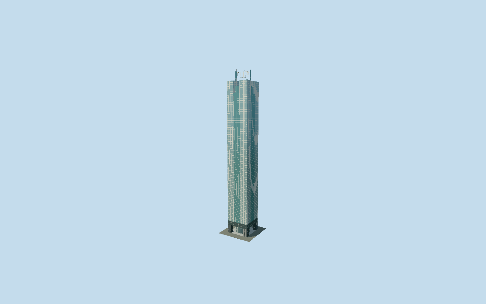

# CITIC Plaza

Complete main office tower with pale split side slabs, teal center, round crown/lobby, dark base, geometric 中信 sign and twin390.2m white masts.

## Evidence and reconstruction

Published dimensions and reconstructed details are separated in spec.json. Primary references:

- [Reference](https://www.skyscrapercentre.com/building/citic-plaza/242)
- [Reference](https://www.building.com.hk/comprofile/20090813dls.pdf)
- [Reference](https://www.hkexnews.hk/listedco/listconews/sehk/2010/0826/ltn20100826271.pdf)
- [Reference](https://www.openstreetmap.org/way/926228208)

No third-party geometry, photograph or bitmap texture is embedded. Shared surface graphs come from the central library; vertex tints carry model colors. Glazing uses PBR materials; transparent surfaces are declared per model.

## Model and axes

9,422 triangles; 26,758 vertices; 5 material groups; 1,079,648 bytes. Native bounds: -23.875, 0.000, -23.873 to 23.875, 390.200, 23.873. Source hash: `sha256:576e16aa72548ce42a228dfceb7285a89f2df876174b9b2835ecd2916f86bccd`.

{"up":"+Y","longitudinal":"+X east along paired mast/sign baseline","front":"+Z south toward Sports Centre; exact entrance unverified","origin":"Ground-contact center of mapped main office tower"}

The geographic proposal uses exact-QID OpenStreetMap evidence. Map-derived orientation and estimated architectural details require real-site visual review; preview eligibility is distinct from geographic/fidelity approval. Map attribution: © OpenStreetMap contributors, ODbL-1.0.

## Reproduce

Run `node packages/worldgen/scripts/generate-signature-towers.mjs --ids=N0164` (or add `--check`). The generator preserves manually edited masters by checking their baseline hashes. Import through the standard authored-model workflow with optimization disabled; then capture all QA cameras, including shared-surface views.

## Pending work

- Main office tower only, preserving original74676-triangle detailed recipe. Reviewed exterior includes pale-glass split side slabs, teal central shaft and round inner crown, dark lower band, reconstructed round glazed lobby with four mapped dark corner piers, original geometric 中信 sign and paired390.2m white spires. One mapped mast says391.1m; CVU390.2m architectural/tip datum is used for both. CVU occupied296.9m is distinguished from approximate mapped297m office roof,310.8m crown,321.9m side tips and344m sign/support. Facade band spacing, lobby radius, trim widths and sign stroke/brace shapes are approximations from map and actual reference photos. Exact entrances/doors not surveyed. Generic previous4.3m entry canopies are replaced by photo-supported recessed cylindrical lobby. Two separate38-storey apartment towers, shopping arcade/retail podium, basement, plazas, landscaping and interiors remain outside main-tower asset. Quantity surveyor arcade3-storey,2010 developer mall5-storey and current mapretail4-storey descriptions differ and do not establish current arcade model heights. Shared256px concrete/granite/painted-metal surfaces plus component tint; opaque palette glass, zero embedded photographs. True grade, night/sign lighting and physical-device performance unmeasured.

This bundle follows the medium-fi standard. Medium-fi appearance and geographic fit are reviewed separately. Hash-bound visual acceptance is recorded separately after capture inspection.
