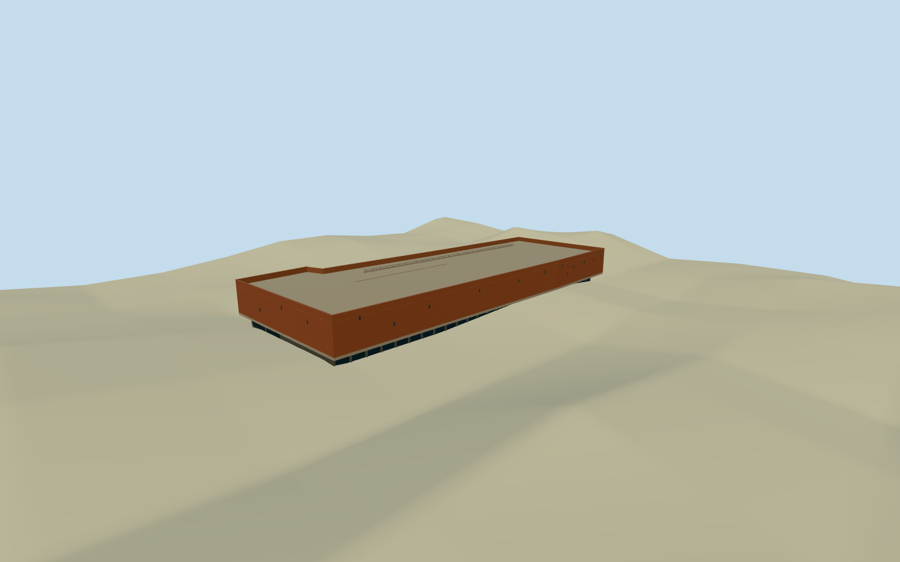

# Nanyue Palace Garden Hall

The red sandstone Palace Garden Hall in Guangzhou, built above the ancient garden watercourse with a shaded public base and open-air upper terrace.

Authoring state: **review-in-qa.json**. Current completion evidence is in [qa.json](qa.json) and the [completion ledger](../../../../qualla-structures/batches/qualla-004.PROGRESS.md).

- [Nanyue King Museum](https://qualla.com/nanyue-king-museum/)

The road-front Palace Garden Hall is represented. The institution’s tomb branch, separate archaeological exhibition halls, staged plaza events and unverified interior rooms remain outside scope.

The named full footprint and older east building outline govern width and orientation. The height, rear elevation and roof terrace subdivision use visual or documented proportion estimates.

Build: `node content/worldgen/source/places/ws/ws0/nanyue_king_museum/models/generate-nanyue-king-museum.mjs`. Add `--check` to verify exact regeneration. 2287 triangles; 5 materials; no embedded photographs.
