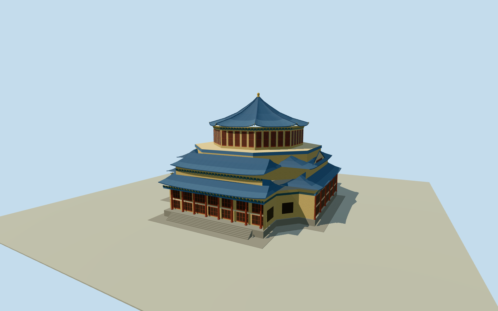

# Sun Yat-sen Memorial Hall, Guangzhou

Sun Yat-sen Memorial Hall in Guangzhou with its octagonal blue roof, gold finial, and four glazed double-eaved ranges.

Authoring state: **review-in-qa.json**. Current completion evidence is in [qa.json](qa.json) and the [completion ledger](../../../../qualla-structures/batches/qualla-003.PROGRESS.md).

- [Sun Yat-sen Memorial Hall (Guangzhou)](https://qualla.com/sun-yat-sen-memorial-hall-guangzhou/)

May 2013 main hall. Detached gate, garden structures, monument and statue are outside the exterior asset.

Roof tier sections, mouldings, inscriptions, and individual glazing bays are approximate where the accepted images provide incomplete coverage.

The original terrain samples are preserved. The renderer clips the source surface inside the estimated granite apron to clear the hall and entrance steps. Retaining edges and local thresholds are approximate.

Build: `node content/worldgen/source/places/ws/ws0/sun_yat_sen_memorial_hall_guangzhou/models/generate-memorial.mjs`. Add `--check` to verify exact regeneration. 15975 triangles; 5 materials; no embedded photographs.
