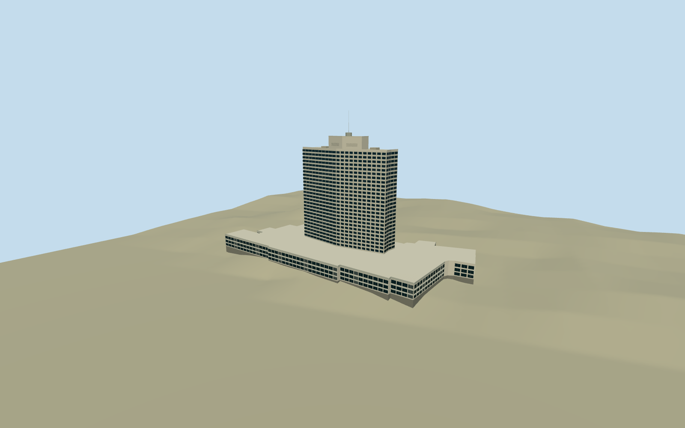

# White Swan Hotel

The White Swan Hotel on Shamian Island, with the riverfront podium, angular pale tower, repeating oblique guestroom bays, stepped roof equipment and antenna.

Authoring state: **review-in-qa.json**. Current completion evidence is in [qa.json](qa.json) and the [completion ledger](../../../../qualla-structures/batches/qualla-003.PROGRESS.md).

- [White Swan Hotel](https://qualla.com/white-swan-hotel/)

The podium bay rhythm, white facing materials, and balcony dimensions are reconstructed from the published photograph, official written context and outlines. Glazing and panel patterns on faces beyond the photograph are approximate.

Shamian’s public embankment, waterfront landscaping, detached structures, hotel interior and approach viaduct beyond the attached entrance are outside the selected scope.

Build: `node content/worldgen/source/places/ws/ws0/white_swan_hotel/models/generate-white-swan-hotel.mjs`. Add `--check` to verify exact regeneration. 15852 triangles; 6 materials; no embedded photographs.
