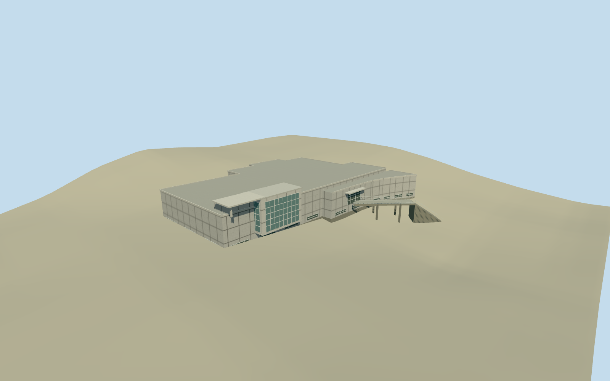

# He Xiangning Art Museum

The He Xiangning Art Museum at 9013 Shennan Boulevard, with pale paneled walls, projecting glazed gallery and elevated entrance walk.

Authoring state: **review-in-qa.json**. Current completion evidence is in [qa.json](qa.json) and the [completion ledger](../../../../qualla-structures/batches/qualla-004.PROGRESS.md).

- [He Xiangning Art Museum](https://qualla.com/he-xiangning-art-museum/)

The two attached mapped volumes and museum approach. Neighboring museums, road features and advertisements are outside scope.

Unpublished vertical dimensions, structure of the pedestrian walk and rear façade openings are estimated.

Build: `node content/worldgen/source/places/ws/ws1/he_xiangning_art_museum/models/generate-he-xiangning-art-museum.mjs`. Add `--check` to verify exact regeneration. 3774 triangles; 6 materials; no embedded photographs.
