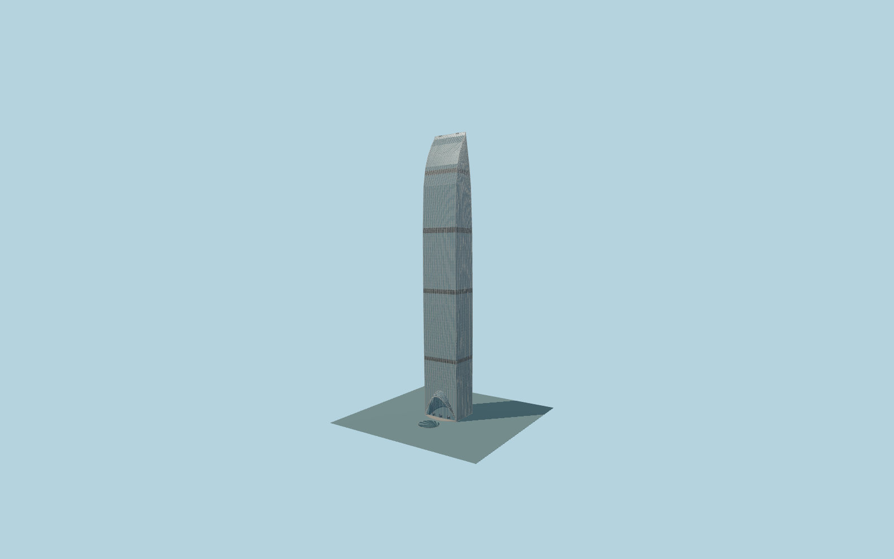

# Kingkey100

Complete442m Kingkey100 tower:bowed blue-gray curtain-wall enclosure,continuous pale vertical fins,four dark mechanical belts,curved crown/roof plant andthe arched south glass hood with diamond lattice,recessed revolving-door lobby andcircular watercourt.

Original source:models/kingkey-model.mjs,layout.json andattributed standard map/global-terrain controls. Rebuild with `node packages/worldgen/scripts/generate-kingkey-100.mjs`;append `--check` for exact bytes. Import/LOD commands select `--ids=kingkey_100`. GLBs are ignored outputs.

Four existing shared256px graphs;no private or embedded images. Detailed master andfour browser tiers remain separate. Retained Q1470046 plan andindependent441.8m shaft/44m south hood fix placement,scale andorientation. +X east,+Z south entrance/watercourt;independent northern KK Mall is preserved as native map geometry. Curved crown,mechanical belts,facade/door/hood/pool inventories andgrades remain photo-proportional approximations. Unmodified global native field,18m center reference;no surveyed site-fit certificate. See model-brief.json andqa.json for scope/current review.

Original geometry uses the repository license. Maps:© OpenStreetMap contributors,ODbL-1.0;Protomaps. Global terrain hashes/attribution:terrain-grid.json. Linked ordinary pictures are not redistributed or used as textures.
