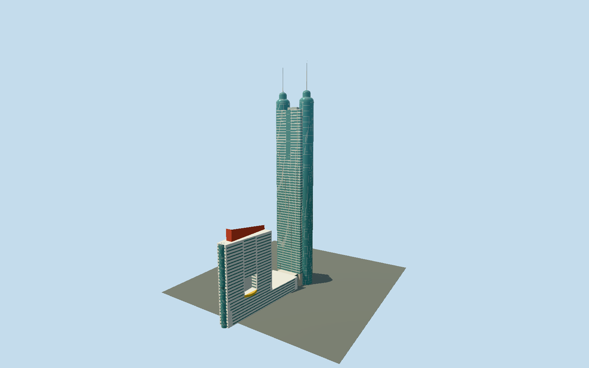

# Shun Hing Square

Complete green twin-cylinder tower with cream horizontal bands, stepped syringe crowns,384m spires and T-shaped shopping/apartment annex.

## Evidence and reconstruction

Published dimensions and reconstructed details are separated in spec.json. Primary references:

- [Reference](https://www.skyscrapercenter.com/building/shun-hing-square/258)
- [Reference](https://www.eng.nipponsteel.com/files_publish/page/131/Special%20Steel%20Structure.pdf)
- [Reference](https://www.rlb.com/wp-content/uploads/sites/5/2020/09/RLB-Tall-Buildings-Global1.pdf)
- [Reference](https://www.openstreetmap.org/way/64601041)

No third-party geometry, photograph or bitmap texture is embedded. Shared surface graphs come from the central library; vertex tints carry model colors. Glazing uses PBR materials; transparent surfaces are declared per model.

## Model and axes

38,515 triangles; 106,999 vertices; 4 material groups; 4,316,964 bytes. Native bounds: -35.890, 0.000, -20.020 to 35.802, 384.000, 181.850. Source hash: `sha256:029d22029a32d35f8aaa2d6f1bfe5cee0da2ade087990434a8144b5cef27633c`.

{"up":"+Y","longitudinal":"+X south-southeast","front":"+Z west-southwest; doors unverified","origin":"Mapped main tower ground-contact frame"}

The geographic proposal uses exact-QID OpenStreetMap evidence. Map-derived orientation and estimated architectural details require real-site visual review; preview eligibility is distinct from geographic/fidelity approval. Map attribution: © OpenStreetMap contributors, ODbL-1.0.

## Reproduce

Run `node packages/worldgen/scripts/generate-signature-towers.mjs --ids=N0167` (or add `--check`). The generator preserves manually edited masters by checking their baseline hashes. Import through the standard authored-model workflow with optimization disabled; then capture all QA cameras, including shared-surface views.

## Pending work

- Complete main tower and previously missing apartment annex/shopping podium: mapped69-storey rectangular body with curved side cutouts, two12.06m green cylinders, cream bands/upper center panels, stepped syringe crowns and384m masts. Original311345-triangle/28860096byte master recipe preserved. Main body302m/cylinders313m/crown334m and cylinder radii reconstructed; published384m/298m occupied/298.1m observatory used, no claimed floor/crown survey. Main69floor rhythm retained near/street, distant bands aggregated. Low entry22m and apartment levels converted with assumed3.4m residential floor height above22m five-storey shopping datum. Explicit mapped minimum-level voids preserved, central support core through pool court inferred to avoid unsupported bridge. Red central spine/skillion8degree roof, yellow ninth-level side projections and rounded green annex end reconstructed from map/material tags and actual LERA photos, not measured facade/door bearing. Pool22m wide opening is described byCVU; water position/size reconstructed on supported35.6m courtyard roof. Ground plaza, subterranean floors, interiors, exact facade lettering/nightlaser and dynamic lights excluded. Shared256px granite/concrete/paintedmetal graphs; opaque glass/pool palette; zero photographic textures. Terrain slope and physical-device timing unmeasured. Added tall west apartment wing from completed LERA photos02–03: nine-level map way represents lower enclosure, not full upper facade. West wing reconstructed to117.2m (33floor datum); rounded glass west end reaches117.2m with56–59.4m narrowed join. Central red spine35floor datum124m plus assumed8degree sloped roof gives134.14m maximum, not a published annex height. Main central body uses rectangle inside overlapping cylindrical shafts; union preserves exterior curved side profile. Reconstructed22m brown stone base and east-side triangular opaque glass portal with two structural diagonals follow LERAphoto01; exact doorway dimensions unsurveyed.

This bundle follows the medium-fi standard. Medium-fi appearance and geographic fit are reviewed separately. Hash-bound visual acceptance is recorded separately after capture inspection.
