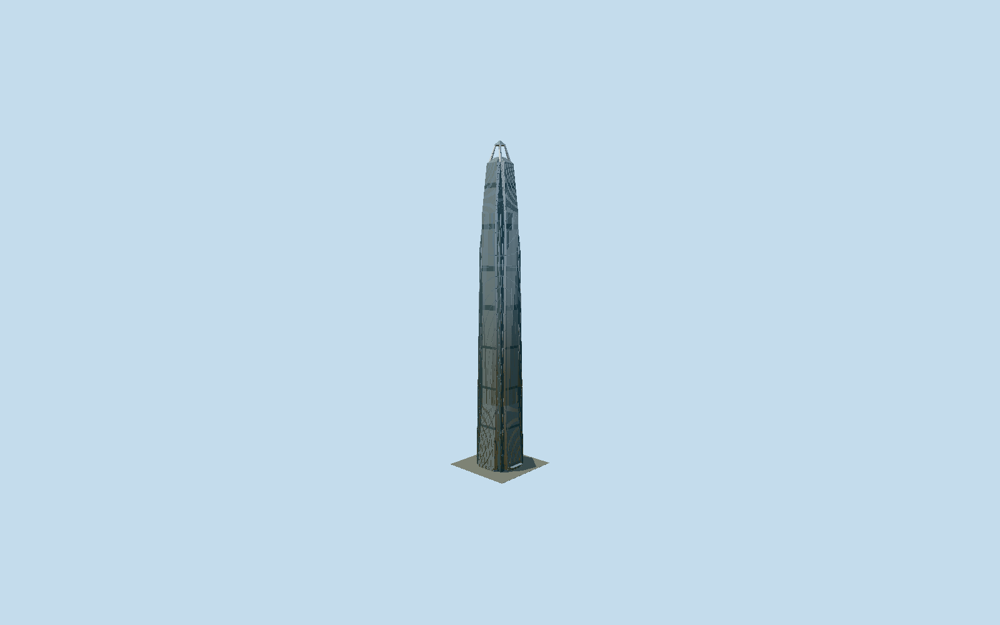

# Ping An Finance Center

Shenzhen’s stainless-clad North Tower, tapering double-notched square sections, paired supercolumns, recessed braced corners, fine pointed facade piers, folded eastern canopy and genuinely open four-legged crown below its small glass pyramid.

## Evidence and reconstruction

Published dimensions and reconstructed details are separated in spec.json. Primary references:

- [Reference](https://www.kpf.com/project/ping-an-finance-centre)
- [Reference](https://www.thorntontomasetti.com/project/ping-international-finance-centre-north-tower)
- [Reference](https://www.skyscrapercenter.com/building/ping-an-finance-center/54)
- [Reference](https://www.outokumpu.com/en/expertise/2016/megatall-with-iconic-steel-facade)
- [Reference](https://global.ctbuh.org/resources/papers/download/1997-anything-goes.pdf)
- [Reference](https://www.openstreetmap.org/way/535860513)

No third-party geometry, photograph or bitmap texture is embedded. Shared surface graphs come from the central library; vertex tints carry model colors. Glazing uses PBR materials; transparent surfaces are declared per model.

## Model and axes

56,588 triangles; 153,144 vertices; 3 material groups; 6,194,616 bytes. Native bounds: -38.519, 0.000, -38.519 to 44.799, 599.167, 38.519. Source hash: `sha256:543515859c463e6f302bff8ca78596c30e3919226e6668e922819870fca4e474`.

{"up":"+Y","longitudinal":"+X east","front":"+X east Yitian Road entry","origin":"Mapped North Tower envelope at reconstructed open-air entrance grade"}

Fresh OSM API2026-10-10 confirms Q1077308 whole535860513 and54 facade/crown patches unchanged from independently saved2026-09-28 map-parts. Signed heading0.0005397205 keeps +X east toward separately mapped Yitian Road996752254 and the completed architect entrance photograph; +Z south. Double-notched lower plan, sloped facade patches and9.1m upper cap support the North Tower reconstruction; skillion tags are surface slopes, not occupied roof solids. SourceY0 is reconstructed open-air entrance grade, not surveyed elevation. Current CVU599.1m tip/555.6m occupied/562.2m observatory override architect/engineer rounded600m. Ground envelope reconstruction allowance2m/1degree excludes projecting folded entry canopy; no automatic footprint replacement. Separate retail podium, South Tower, landscape, moving equipment and interiors excluded.

## Reproduce

Run `node packages/worldgen/scripts/generate-signature-towers.mjs --ids=ping_an_finance_centre` (or add `--check`). The generator preserves manually edited masters by checking their baseline hashes. Import through the standard authored-model workflow with optimization disabled; then capture all QA cameras, including shared-surface views.

## Pending work

- Original245790-triangle/28274144-byte master remains byte-reproducible from unchanged recipe. Reviewed source uses full backing glass/steel faces, merged pointed pier spans, continuous facade seals and sparse physical steel joints/louvres instead of repeated framed pane islands. Double-notched taper, eight supercolumn casings, seven mechanical-band intervals, recessed diagonal strips, sloping glazed roof, four separate open crown legs, small pyramid, eastern folded canopy, splayed braces and three revolving doors retained. Skyline omits separate piers, braces, joints, louvres and fine tip/entry frames, averaging shared steel/stone colours into one group. District restores sampled piers and coarse recessed braces; street restores all nine face piers, aggregate seams/louvres and roof/door grids; close-up restores fine seams/louvres and32-sided doors within64000triangles. Original fine repeat density is preserved through original recipe, not every small master component in reviewed source. Canonical stainless and granite graphs approximate Deco Linen steel and dark stone; coated canopy/recess shares steel/glazing respectively to keep three near draws. Zero embedded images. Individual dimensions/roof datums/door offsets are reconstructions; finite along-ray1.5/.75/.3/.1m comparisons exclude intentionally omitted narrow seams/louvres/piers/braces, not a global surface-distance bound. Physical-device performance and surveyed grade unmeasured.

This bundle follows the medium-fi standard. Medium-fi appearance and geographic fit are reviewed separately. Hash-bound visual acceptance is recorded separately after capture inspection.
