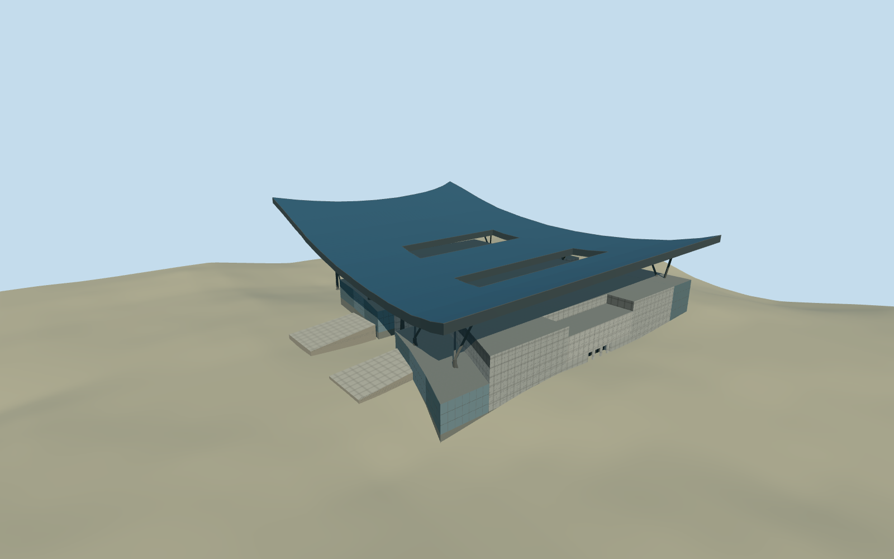

# Shenzhen Museum

The History and Folk Culture wing of Shenzhen Museum with its sweeping steel canopy, modular pale facade, glazed sections and flanking entrance ramps.

Authoring state: **review-in-qa.json**. Current completion evidence is in [qa.json](qa.json) and the [completion ledger](../../../../qualla-structures/batches/qualla-004.PROGRESS.md).

- [Shenzhen Museum](https://qualla.com/shenzhen-museum/)

The model covers the history and folk culture venue and its section of the Civic Center canopy. Exact steel joints, panel modules and unobserved openings are approximated.

Build: `node content/worldgen/source/places/ws/ws1/shenzhen_museum/models/generate-shenzhen-museum.mjs`. Add `--check` to verify exact regeneration. 4033 triangles; 6 materials; no embedded photographs.
