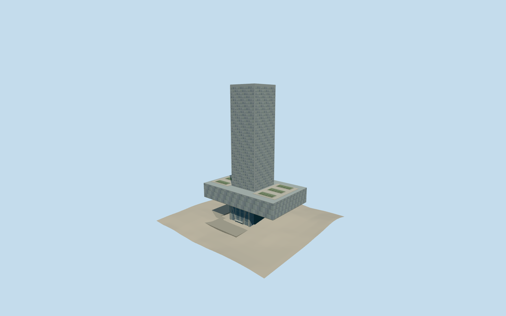

# Shenzhen Stock Exchange

The Futian headquarters of Shenzhen Stock Exchange, with a gridded glass tower, raised cantilevered exchange podium and open space underneath.

Authoring state: **review-in-qa.json**. Current completion evidence is in [qa.json](qa.json) and the [completion ledger](../../../../qualla-structures/batches/qualla-003.PROGRESS.md).

- [Shenzhen Stock Exchange](https://qualla.com/shenzhen-stock-exchange/)

The native envelopes and published engineering facts establish the tower, podium and street clearance. Glazing rhythm, plaza features, interior structure visible through the glass, roof landscaping and detailed cladding are estimated.

The model adopts the mapped 245.8 metre architectural height for the tower. Some design descriptions give a nominal 254 metres. Public sources differ in measurement conventions.

The original elevation is preserved. Adjacent skyscrapers, metro works, corporate trademarks and the historic exchange site in Luohu are outside scope.

Build: `node content/worldgen/source/places/ws/ws1/shenzhen_stock_exchange/models/generate-shenzhen-stock-exchange.mjs`. Add `--check` to verify exact regeneration. 15192 triangles; 5 materials; no embedded photographs.
