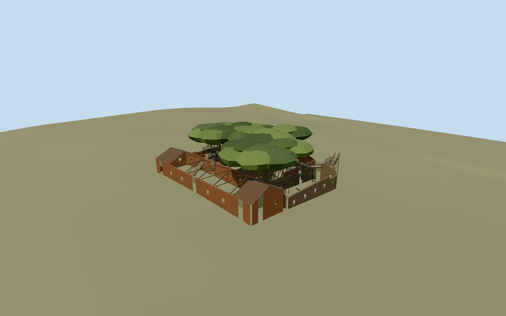

# Anping Tree House

Five partly roofless former red-brick warehouses in Tainan with three broad banyan groups, aerial roots and raised timber walks on black steel.

Authoring state: **review-in-qa.json**. Current completion evidence is in [qa.json](qa.json) and the [completion ledger](../../../../qualla-structures/batches/qualla-003.PROGRESS.md).

- [Anping Tree House](https://qualla.com/anping-tree-house/)

The garden boundary and outside paths come from the native map. Individual warehouse outlines, internal layout, wall heights, and the placement and profiles of roots and canopies are estimates using the published aggregate area and descriptions.

The modern wooden visitor walk, stairs and three black steel platforms are reconstructed at representative positions inside the surviving warehouse sector. The mapped continuation to the north gives the exit bearing. Fine roof remnants, mortar color and rail details are approximate.

The separately named merchant house, former residence, cafe, garden attractions and landscape beyond the old warehouse are outside scope.

Build: `node content/worldgen/source/places/ws/wsj/anping_tree_house/models/generate-anping-tree-house.mjs`. Add `--check` to verify exact regeneration. 16248 triangles; 7 materials; no embedded photographs.
