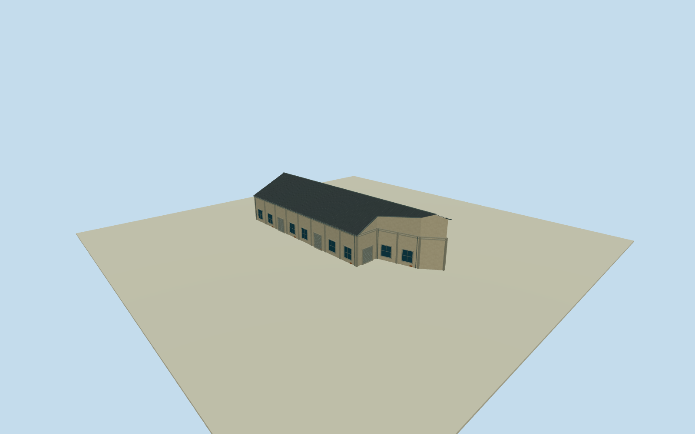

# Dayi C11 Warehouse

Whole independent original Dayi C11 Warehouse/way203315638/refC11, all 9 original native outside controls/full walls/base/full roof, including any mapped clipped corner or rear extension. Separate neighboring bodies excluded. Exact cleared2015 C5overview supplies general local Pier2warehouse construction family only; all elevations/heights/sections/opening census estimates. Current native tenant tags contextual only, no2015function/signage claim. Original independent Dayi C11 Warehouse/way203315638/refC11, all 9 native controls must remain in full outer body. Original0to1shortedge defines+Xgablewidth/signed+Zridge along main warehouse direction. Current native footprint approximately registers2015appearance. Distinct neighboring bodies excluded; all member elevations/sections/openings are local C5warehouse family estimates. Do not replace irregular native corners or extensions with a bounding box. Whole independent native Dayi C11 warehouse, all original controls, walls, base, all end faces and full gray pitched roof. Separate neighboring bodies excluded. Exact already-cleared2015 C5overview photograph53500205916 supplies general local pale weathered stucco/concrete framing/gray roof/bluegray window/roller vocabulary only. Every Dayi C11 elevation, section and opening census estimated; no direct photograph label claim or copied B7oval/C7panel. Floor.25/foundation-2.1/eave6.45/ridge10.65 chosen once after original field and before geometry. Heights6.2/10.4m above floor have2m uncertainty. Original native corner relative grades[-1.1292065205294692,-1.8370363121960747,0.3704668669034703,0.18114539978035893,0.3805798376632943,0.3067494618157385,0.15022741015578145,-0.16653479472567234,-0.5564266896837013]m; closing skirt is estimated buried extension, not surveyed basement. Historical ground/vertical tie unknown. Original frame/field unchanged; no flattening, masking or floor/roof refit. All 9 original outside corners retained, including clipped corner or narrow rear extension. Longwall edges individually divided into estimated4.7m bays; all panels and piers placed along actual native edges. Two rollers on each long main wall and estimated windows on shorter longitudinal extension walls; two closed end-face service entries, concrete framing and small brick base repairs. Precise roof pitch/covering/.35moverhang/facing/openings/hidden details are local family estimates with2m uncertainty. Full continuous pitched roof extends over the entire original irregular outline; exact rear-wing historic roof division unknown. Independent256m129x129field/16641heights/1rawtile/datum5.5103m frozen before geometry. Isolated review plane shows above-floor exterior; raw turntables expose estimated skirt. Original unmasked field separately inspected. Qualla-first38families/zero conflicts previously screened. Reused exact already-cleared photographer53500205916/NSID137596559@N07 CC0original, primary creator/native owner/license9/original URL/dimensions/byte proof bound. Full original previously personally inspected; no repeated source queries/downloads. Signs/posters/art/people/vehicles/photo textures unused. All four LODs retain the entire native irregular envelope, clipped corner or narrow rear extension; facade panels, pilasters, both gables and roof are bilinearly mapped to the original four controls with recomputed outward normals. Original source frame/field unchanged. All four LODs retain whole body/full roof/ridge/all native walls/base/end faces/pilasters/window-roller panels/closed entries. Higher LODs restore mullions/frames/gutters/flutes/corrugation. Parent Pier2 ensemble unfinished; accepted neighboring assets preserved.

Authoring state: **review-in-qa.json**. Current completion evidence is in [qa.json](qa.json) and the [completion ledger](../../../../qualla-structures/batches/qualla-002.PROGRESS.md).

- [Pier-2 Art Center](https://qualla.com/pier-2-art-center/)

Whole independent original Dayi C11 Warehouse/way203315638/refC11, all 9 original native outside controls/full walls/base/full roof, including any mapped clipped corner or rear extension. Separate neighboring bodies excluded. Exact cleared2015 C5overview supplies general local Pier2warehouse construction family only; all elevations/heights/sections/opening census estimates. Current native tenant tags contextual only, no2015function/signage claim.

Original independent Dayi C11 Warehouse/way203315638/refC11, all 9 native controls must remain in full outer body. Original0to1shortedge defines+Xgablewidth/signed+Zridge along main warehouse direction. Current native footprint approximately registers2015appearance. Distinct neighboring bodies excluded; all member elevations/sections/openings are local C5warehouse family estimates. Do not replace irregular native corners or extensions with a bounding box.

Whole independent native Dayi C11 warehouse, all original controls, walls, base, all end faces and full gray pitched roof. Separate neighboring bodies excluded. Exact already-cleared2015 C5overview photograph53500205916 supplies general local pale weathered stucco/concrete framing/gray roof/bluegray window/roller vocabulary only. Every Dayi C11 elevation, section and opening census estimated; no direct photograph label claim or copied B7oval/C7panel.

Floor.25/foundation-2.1/eave6.45/ridge10.65 chosen once after original field and before geometry. Heights6.2/10.4m above floor have2m uncertainty. Original native corner relative grades[-1.1292065205294692,-1.8370363121960747,0.3704668669034703,0.18114539978035893,0.3805798376632943,0.3067494618157385,0.15022741015578145,-0.16653479472567234,-0.5564266896837013]m; closing skirt is estimated buried extension, not surveyed basement. Historical ground/vertical tie unknown. Original frame/field unchanged; no flattening, masking or floor/roof refit.

All 9 original outside corners retained, including clipped corner or narrow rear extension. Longwall edges individually divided into estimated4.7m bays; all panels and piers placed along actual native edges. Two rollers on each long main wall and estimated windows on shorter longitudinal extension walls; two closed end-face service entries, concrete framing and small brick base repairs. Precise roof pitch/covering/.35moverhang/facing/openings/hidden details are local family estimates with2m uncertainty. Full continuous pitched roof extends over the entire original irregular outline; exact rear-wing historic roof division unknown.

Independent256m129x129field/16641heights/1rawtile/datum5.5103m frozen before geometry. Isolated review plane shows above-floor exterior; raw turntables expose estimated skirt. Original unmasked field separately inspected.

Qualla-first38families/zero conflicts previously screened. Reused exact already-cleared photographer53500205916/NSID137596559@N07 CC0original, primary creator/native owner/license9/original URL/dimensions/byte proof bound. Full original previously personally inspected; no repeated source queries/downloads. Signs/posters/art/people/vehicles/photo textures unused.

All four LODs retain the entire native irregular envelope, clipped corner or narrow rear extension; facade panels, pilasters, both gables and roof are bilinearly mapped to the original four controls with recomputed outward normals. Original source frame/field unchanged. All four LODs retain whole body/full roof/ridge/all native walls/base/end faces/pilasters/window-roller panels/closed entries. Higher LODs restore mullions/frames/gutters/flutes/corrugation. Parent Pier2 ensemble unfinished; accepted neighboring assets preserved.

Build: `node content/worldgen/source/places/ws/wsj/dayi_c11_warehouse/models/generate-house.mjs`. Add `--check` to verify exact regeneration. 4704 triangles; 5 materials; no embedded photographs.
