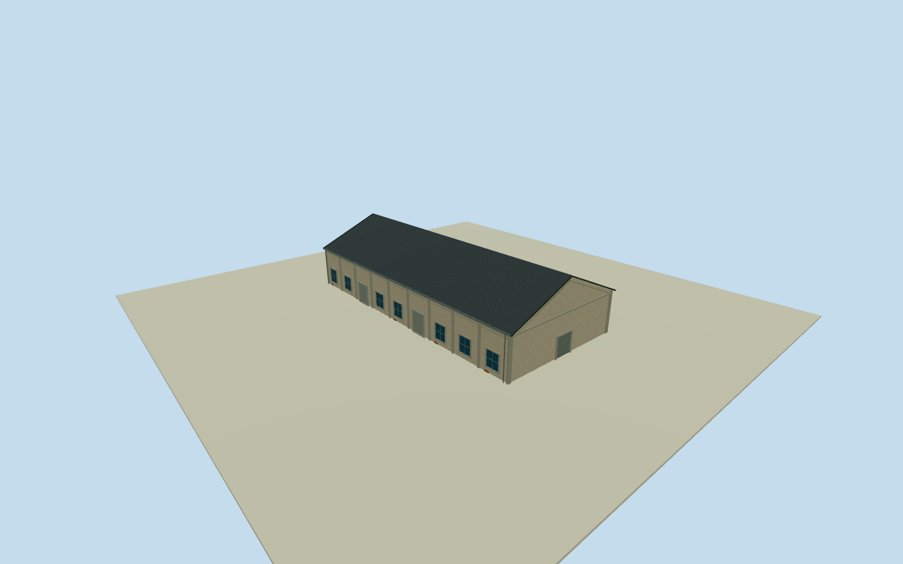

# Dayi C6 North Warehouse

Whole independent original northern Dayi C6 warehouse203315649/refC6, all four native corners/full walls/base/both gables/full pitched roof. Separate southern C6way394378147 and whole Pier2 ensemble excluded. Cleared2015 Dayong C5 warehouse overview provides general neighboring Pier2 industrial construction family only; no direct C6photo identity asserted. Independent original native northern Dayi C6way203315649/refC6, full four outside controls. Separate original southern C6body394378147, C7/C8 context excludes neighbors. Cleared2015 C5overview provides general local warehouse family only; northern C6facades/heights/sections/census explicitly estimated. Original0to1shortedge defines+Xwidth, signed+Zridge south. Native current plan approximately registers2015appearance, not historical survey. Whole independent original northern C6four-control body19.29x41.45m, all walls/base/both gables/full gray pitched roof. Separate southern C6way394378147 and C7/C8 excluded. Already-cleared2015 C5overview53500205916 provides pale weathered stucco/concrete framing/gray roof/bluegray window/roller vocabulary as general neighboring Pier2warehouse family only. All C6elevations/sections/census estimated; no direct C6photo-label claim or B7oval/C7frontpanel. Floor.25/foundation-4.7/eave6.45/ridge10.65 chosen once after original field and before geometry. Heights6.2/10.4m above floor have2m uncertainty. Original native corner grades-4.45522..+.97178m show unsurveyed coastal DEM variation; deep closing skirt is an estimated buried extension, not measured basement. Exact historical ground/vertical tie unknown. No field/frame/floor/roof refit, flattening or masking. Nine estimated longwall bays/seven windows/two rollers each side; broad closed northern entry4.7mwide/plain rear serviceentry/concrete pilasters/brick base patches. Precise roofpitch/covering/.35moverhang/section heights/front-facing designation/hidden walls/opening census/components are2m estimates from local industrial family, not an architectural survey. Original256m129x129independent field/16641heights/1rawtile/datum5.8427m frozen before geometry. Isolated review plane shows above-floor body; raw turntables can expose estimated buried skirt; original unmasked field separately inspected unchanged. Qualla-first38families/zero conflicts screened. Reused exact already-cleared photographer53500205916/NSID137596559@N07 CC0 original, dual primary creator/native owner/license9/original URL/dimensions/byte proof bound. Full original already personally inspected; no repeated source queries/downloads. Protected signs/posters/art/people/vehicles/photo textures unused. All four LODs retain whole northern C6body/full roof/ridge/all walls/base/gables/pilasters/window-roller panels/closed entrances. Higher LODs restore mullions/frames/gutters/flutes/corrugation. Parent Pier2 ensemble unfinished; no southern C6 geometry duplicated.

Authoring state: **review-in-qa.json**. Current completion evidence is in [qa.json](qa.json) and the [completion ledger](../../../../qualla-structures/batches/qualla-002.PROGRESS.md).

- [Pier-2 Art Center](https://qualla.com/pier-2-art-center/)

Whole independent original northern Dayi C6 warehouse203315649/refC6, all four native corners/full walls/base/both gables/full pitched roof. Separate southern C6way394378147 and whole Pier2 ensemble excluded. Cleared2015 Dayong C5 warehouse overview provides general neighboring Pier2 industrial construction family only; no direct C6photo identity asserted.

Independent original native northern Dayi C6way203315649/refC6, full four outside controls. Separate original southern C6body394378147, C7/C8 context excludes neighbors. Cleared2015 C5overview provides general local warehouse family only; northern C6facades/heights/sections/census explicitly estimated. Original0to1shortedge defines+Xwidth, signed+Zridge south. Native current plan approximately registers2015appearance, not historical survey.

Whole independent original northern C6four-control body19.29x41.45m, all walls/base/both gables/full gray pitched roof. Separate southern C6way394378147 and C7/C8 excluded. Already-cleared2015 C5overview53500205916 provides pale weathered stucco/concrete framing/gray roof/bluegray window/roller vocabulary as general neighboring Pier2warehouse family only. All C6elevations/sections/census estimated; no direct C6photo-label claim or B7oval/C7frontpanel.

Floor.25/foundation-4.7/eave6.45/ridge10.65 chosen once after original field and before geometry. Heights6.2/10.4m above floor have2m uncertainty. Original native corner grades-4.45522..+.97178m show unsurveyed coastal DEM variation; deep closing skirt is an estimated buried extension, not measured basement. Exact historical ground/vertical tie unknown. No field/frame/floor/roof refit, flattening or masking.

Nine estimated longwall bays/seven windows/two rollers each side; broad closed northern entry4.7mwide/plain rear serviceentry/concrete pilasters/brick base patches. Precise roofpitch/covering/.35moverhang/section heights/front-facing designation/hidden walls/opening census/components are2m estimates from local industrial family, not an architectural survey.

Original256m129x129independent field/16641heights/1rawtile/datum5.8427m frozen before geometry. Isolated review plane shows above-floor body; raw turntables can expose estimated buried skirt; original unmasked field separately inspected unchanged.

Qualla-first38families/zero conflicts screened. Reused exact already-cleared photographer53500205916/NSID137596559@N07 CC0 original, dual primary creator/native owner/license9/original URL/dimensions/byte proof bound. Full original already personally inspected; no repeated source queries/downloads. Protected signs/posters/art/people/vehicles/photo textures unused.

All four LODs retain whole northern C6body/full roof/ridge/all walls/base/gables/pilasters/window-roller panels/closed entrances. Higher LODs restore mullions/frames/gutters/flutes/corrugation. Parent Pier2 ensemble unfinished; no southern C6 geometry duplicated.

Build: `node content/worldgen/source/places/ws/wsj/dayi_c6_north_warehouse/models/generate-house.mjs`. Add `--check` to verify exact regeneration. 4158 triangles; 5 materials; no embedded photographs.
