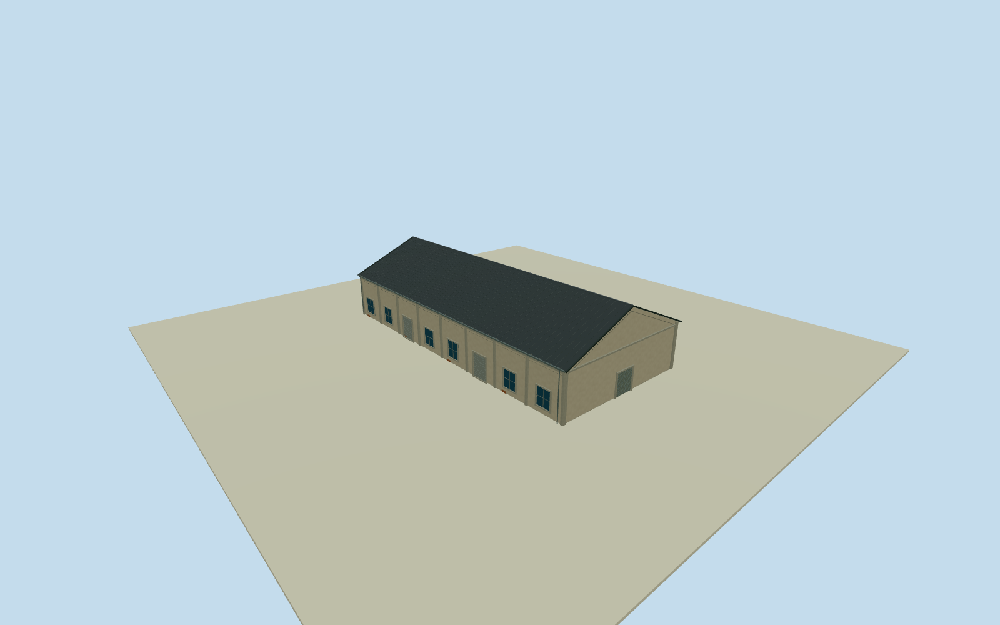

# Dayi C6 South Warehouse

Whole independent original southern Dayi C6 warehouse394378147/refC6, all four native outside corners/full walls/base/both gables/full pitched roof. Separate completed northern C6way203315649 and C7/C8 southern bodies excluded. Cleared2015 C5overview is general local warehouse family only, all southern C6elevations/sections/census estimated. Independent original southern Dayi C6way394378147/refC6, all four native outside controls; northern C6way203315649 separate. Native C7South/C8South establish row context. Already-cleared2015 C5warehouse overview53500205916 provides only general Pier2warehouse stucco/concrete/gable-roof/window/roller family; all C6south elevations/height/pitch/census/hidden sides estimated. Original0to1shortedge defines+Xwidth and signed+Zridge south; current native plan approximately registers2015appearance without survey. Full original independent four-control southern C6warehouse, all walls/base/both gables/full gray pitched roof; northern C6way203315649 completed separately. Exact cleared2015 C5overview53500205916 supplies general Pier2warehouse stucco/concrete/gray roof/window/roller construction family only; all C6south elevations/sections/census estimated, no direct C6label or facade photograph claim. Floor.25/foundation-2.15/eave6.45/ridge10.65 selected once after original independent field and before geometry. Heights6.2/10.4m above floor have2m uncertainty. Original corner grades-1.88729..+1.51784m, below-grade closing skirt estimated rather than surveyed basement. Historical vertical tie unsurveyed; no field/frame/floor/roof refit, flattening or masking. Eight estimated longwall bays/six window panels/two rollers eachside, broad closed northern gableentry4.7mwide/plain smaller rear serviceentry/concrete framing/brick base patches. Precise height/pitch/gray covering/.35moverhang/main-front designation/pilaster dimensions/hidden walls/opening census are2m component estimates. No B7oval/C7raisedpanel or protected graphics copied. Original independent256m129x129field/16641heights/1rawtile/datum5.11m frozen before geometry; isolated flat review shows above-floor exterior, raw turntables expose estimated buried extension, separate original unmasked field unchanged. Qualla-first38families/zero conflicts already screened. Same exact cleared2015 photographer53500205916/NSID137596559@N07 CC0 original, primary dual creator/native owner/license9/exact original URL/dimensions/bytes bound. Original already personally inspected; no new rights query/download. Signs/posters/art/people/vehicles/photo textures unused. All four LODs retain whole native southern C6body/roof/ridge/base/all walls/gables/pilasters/window-roller panels/closed entrances; finer frames/mullions/flutes/gutters/corrugation simplify with distance. One independent physical warehouse, whole Pier2ensemble unfinished.

Authoring state: **review-in-qa.json**. Current completion evidence is in [qa.json](qa.json) and the [completion ledger](../../../../qualla-structures/batches/qualla-002.PROGRESS.md).

- [Pier-2 Art Center](https://qualla.com/pier-2-art-center/)

Whole independent original southern Dayi C6 warehouse394378147/refC6, all four native outside corners/full walls/base/both gables/full pitched roof. Separate completed northern C6way203315649 and C7/C8 southern bodies excluded. Cleared2015 C5overview is general local warehouse family only, all southern C6elevations/sections/census estimated.

Independent original southern Dayi C6way394378147/refC6, all four native outside controls; northern C6way203315649 separate. Native C7South/C8South establish row context. Already-cleared2015 C5warehouse overview53500205916 provides only general Pier2warehouse stucco/concrete/gable-roof/window/roller family; all C6south elevations/height/pitch/census/hidden sides estimated. Original0to1shortedge defines+Xwidth and signed+Zridge south; current native plan approximately registers2015appearance without survey.

Full original independent four-control southern C6warehouse, all walls/base/both gables/full gray pitched roof; northern C6way203315649 completed separately. Exact cleared2015 C5overview53500205916 supplies general Pier2warehouse stucco/concrete/gray roof/window/roller construction family only; all C6south elevations/sections/census estimated, no direct C6label or facade photograph claim.

Floor.25/foundation-2.15/eave6.45/ridge10.65 selected once after original independent field and before geometry. Heights6.2/10.4m above floor have2m uncertainty. Original corner grades-1.88729..+1.51784m, below-grade closing skirt estimated rather than surveyed basement. Historical vertical tie unsurveyed; no field/frame/floor/roof refit, flattening or masking.

Eight estimated longwall bays/six window panels/two rollers eachside, broad closed northern gableentry4.7mwide/plain smaller rear serviceentry/concrete framing/brick base patches. Precise height/pitch/gray covering/.35moverhang/main-front designation/pilaster dimensions/hidden walls/opening census are2m component estimates. No B7oval/C7raisedpanel or protected graphics copied.

Original independent256m129x129field/16641heights/1rawtile/datum5.11m frozen before geometry; isolated flat review shows above-floor exterior, raw turntables expose estimated buried extension, separate original unmasked field unchanged.

Qualla-first38families/zero conflicts already screened. Same exact cleared2015 photographer53500205916/NSID137596559@N07 CC0 original, primary dual creator/native owner/license9/exact original URL/dimensions/bytes bound. Original already personally inspected; no new rights query/download. Signs/posters/art/people/vehicles/photo textures unused.

All four LODs retain whole native southern C6body/roof/ridge/base/all walls/gables/pilasters/window-roller panels/closed entrances; finer frames/mullions/flutes/gutters/corrugation simplify with distance. One independent physical warehouse, whole Pier2ensemble unfinished.

Build: `node content/worldgen/source/places/ws/wsj/dayi_c6_south_warehouse/models/generate-house.mjs`. Add `--check` to verify exact regeneration. 3982 triangles; 5 materials; no embedded photographs.
