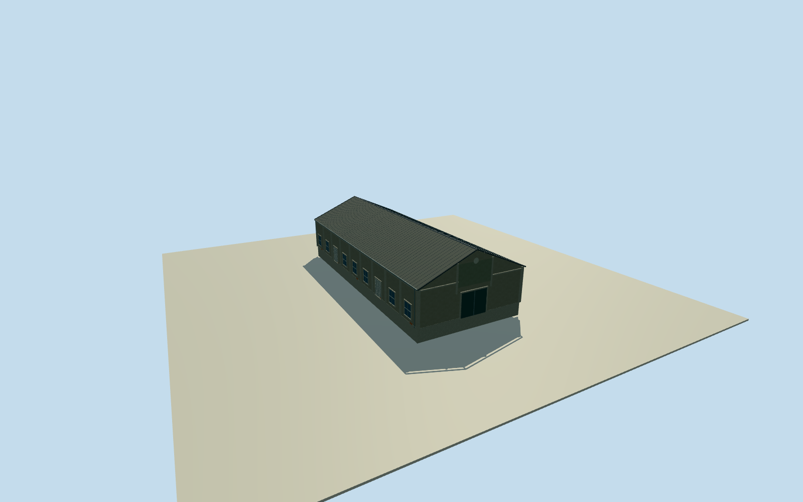

# Dayi C7 North Warehouse

Whole independent northern Dayi C7 native warehouse 203315650, all 4 original unique controls. Distinct other C7 body excluded. Native current plan approximately registers2015 appearance. Primary photo53499321477 depicts the Penglai B7 warehouse row, corroborated by separately cleared close gable photo53500624705. It does not identify Dayi C7. Used only as general Pier2 industrial warehouse construction vocabulary. Native C7 identity/whole footprint are independently mapped; every C7 facade, front panel/cartouche, height and section is an explicit approximate reconstruction, not a photographed C7 feature. Original native 4-control full body/base/all walls/both gables/full pitched roof retained. Floor0.25/base-2.2/eave6.45/ridge10.65 chosen before geometry and unchanged. Heights and facade components have2m uncertainty; all C7 elevations/door-window census/panel/cartouche interpretations are estimates. Floor.25/foundation-2.2/eave6.45/ridge10.65 chosenonce afterindependent originalfield and beforegeometry.6.2meave/10.4mridge abovefloor have2mheightuncertainty; precise roofpitch/overhang.3m, centralraisedgablepanel/plainroundcartouche/mainclosedentry/9sidebays/2rollerdoors/7windowpanels perlongside are original2mcomponentestimates. B7 photo is warehouse family evidence only. Hiddenlongwalls/rear/sourceera details conservativeestimatedcontinuation. Original256m129x129field/16641heights/1rawtile/datum1.9318m fixedbeforefloors/sections. Nativecornerrelativegrades-1.92313..+2.98745m show unsurveyed sourcegrade variation; foundation-2.2 is an estimatedbelow-grade closing skirt. Exactthreshold andhistoricalverticaltie unavailable. Do notflatten/mask/refetch/reframe orrefitfloor/roof to concealgrade limitations. AllfourLODs retainwholemappedbody/fullroof/ridge/gableends/pilasters/frontentry/raisedgablepanel. Districtandhigherrestoreplainroundgablecartouche/doorandwindowframes; streetaddsdrains, closeuproofcorrugation/doorflutes. Cartoucheis a plainarchitecturaldisk, notcopiedsymbol/artwork. ParentPier2ensemble remainsunfinished.

Authoring state: **review-in-qa.json**. Current completion evidence is in [qa.json](qa.json) and the [completion ledger](../../../../qualla-structures/batches/qualla-002.PROGRESS.md).

- [Pier-2 Art Center](https://qualla.com/pier-2-art-center/)

Whole independent northern Dayi C7 native warehouse 203315650, all 4 original unique controls. Distinct other C7 body excluded. Native current plan approximately registers2015 appearance. Primary photo53499321477 depicts the Penglai B7 warehouse row, corroborated by separately cleared close gable photo53500624705. It does not identify Dayi C7. Used only as general Pier2 industrial warehouse construction vocabulary. Native C7 identity/whole footprint are independently mapped; every C7 facade, front panel/cartouche, height and section is an explicit approximate reconstruction, not a photographed C7 feature.

Original native 4-control full body/base/all walls/both gables/full pitched roof retained. Floor0.25/base-2.2/eave6.45/ridge10.65 chosen before geometry and unchanged. Heights and facade components have2m uncertainty; all C7 elevations/door-window census/panel/cartouche interpretations are estimates.

Floor.25/foundation-2.2/eave6.45/ridge10.65 chosenonce afterindependent originalfield and beforegeometry.6.2meave/10.4mridge abovefloor have2mheightuncertainty; precise roofpitch/overhang.3m, centralraisedgablepanel/plainroundcartouche/mainclosedentry/9sidebays/2rollerdoors/7windowpanels perlongside are original2mcomponentestimates. B7 photo is warehouse family evidence only. Hiddenlongwalls/rear/sourceera details conservativeestimatedcontinuation.

Original256m129x129field/16641heights/1rawtile/datum1.9318m fixedbeforefloors/sections. Nativecornerrelativegrades-1.92313..+2.98745m show unsurveyed sourcegrade variation; foundation-2.2 is an estimatedbelow-grade closing skirt. Exactthreshold andhistoricalverticaltie unavailable. Do notflatten/mask/refetch/reframe orrefitfloor/roof to concealgrade limitations.

AllfourLODs retainwholemappedbody/fullroof/ridge/gableends/pilasters/frontentry/raisedgablepanel. Districtandhigherrestoreplainroundgablecartouche/doorandwindowframes; streetaddsdrains, closeuproofcorrugation/doorflutes. Cartoucheis a plainarchitecturaldisk, notcopiedsymbol/artwork. ParentPier2ensemble remainsunfinished.

Build: `node content/worldgen/source/places/ws/wsj/dayi_c7_north_warehouse/models/generate-house.mjs`. Add `--check` to verify exact regeneration. 3936 triangles; 5 materials; no embedded photographs.
