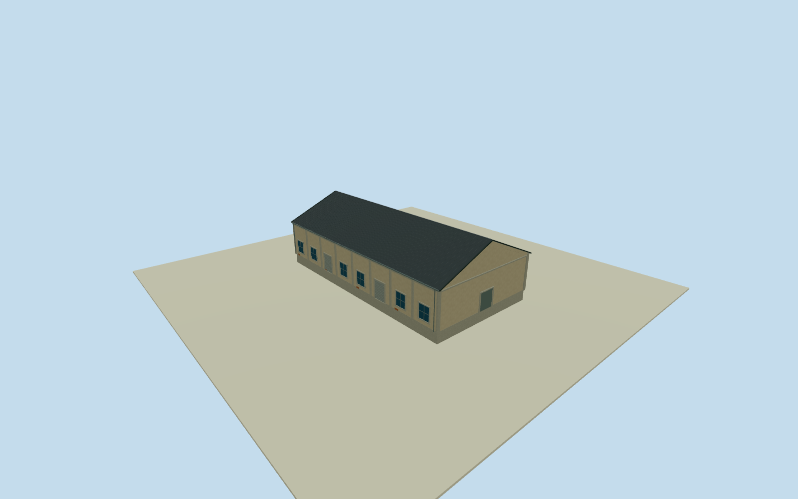

# Dayi C7 South Warehouse

Whole independent southern Dayi C7 native warehouse 394378148, all 5 original unique controls. Distinct other C7 body excluded. Native current plan approximately registers2015 appearance. Primary photo53499321477 depicts the Penglai B7 warehouse row, corroborated by separately cleared close gable photo53500624705. It does not identify Dayi C7. Used only as general Pier2 industrial warehouse construction vocabulary. Native C7 identity/whole footprint are independently mapped; every C7 facade, front panel/cartouche, height and section is an explicit approximate reconstruction, not a photographed C7 feature. Original native 5-control full body/base/all walls/both gables/full pitched roof retained. Floor0.25/base-1.65/eave6.45/ridge10.65 chosen before geometry and unchanged. Heights and facade components have2m uncertainty; all C7 elevations/door-window census/panel/cartouche interpretations are estimates. Floor.25/foundation-1.65/eave6.45/ridge10.65 chosen once after independent original field and before geometry. Heights6.2/10.4m above floor have2m uncertainty. Original corner grades-1.39750..+1.23475m; closing foundation skirt is estimated. Exact historical ground/threshold tie unavailable. Do not refit field/frame/floor/roof or mask/flatten terrain. Original256m129x129 field/16641heights/1 raw tile/datum3.6712m frozen before geometry. Composite DEM is approximate host visualization, not historical threshold survey. All four LODs retain whole five-control body/full pitched roof/ridge/gables/all walls/base/pilasters/estimated closed doors and windows. Higher LODs add window frames/mullions/gutters/corrugation/doorflutes. Parent Pier2 remains unfinished.

Authoring state: **review-in-qa.json**. Current completion evidence is in [qa.json](qa.json) and the [completion ledger](../../../../qualla-structures/batches/qualla-002.PROGRESS.md).

- [Pier-2 Art Center](https://qualla.com/pier-2-art-center/)

Whole independent southern Dayi C7 native warehouse 394378148, all 5 original unique controls. Distinct other C7 body excluded. Native current plan approximately registers2015 appearance. Primary photo53499321477 depicts the Penglai B7 warehouse row, corroborated by separately cleared close gable photo53500624705. It does not identify Dayi C7. Used only as general Pier2 industrial warehouse construction vocabulary. Native C7 identity/whole footprint are independently mapped; every C7 facade, front panel/cartouche, height and section is an explicit approximate reconstruction, not a photographed C7 feature.

Original native 5-control full body/base/all walls/both gables/full pitched roof retained. Floor0.25/base-1.65/eave6.45/ridge10.65 chosen before geometry and unchanged. Heights and facade components have2m uncertainty; all C7 elevations/door-window census/panel/cartouche interpretations are estimates.

Floor.25/foundation-1.65/eave6.45/ridge10.65 chosen once after independent original field and before geometry. Heights6.2/10.4m above floor have2m uncertainty. Original corner grades-1.39750..+1.23475m; closing foundation skirt is estimated. Exact historical ground/threshold tie unavailable. Do not refit field/frame/floor/roof or mask/flatten terrain.

Original256m129x129 field/16641heights/1 raw tile/datum3.6712m frozen before geometry. Composite DEM is approximate host visualization, not historical threshold survey.

All four LODs retain whole five-control body/full pitched roof/ridge/gables/all walls/base/pilasters/estimated closed doors and windows. Higher LODs add window frames/mullions/gutters/corrugation/doorflutes. Parent Pier2 remains unfinished.

Build: `node content/worldgen/source/places/ws/wsj/dayi_c7_south_warehouse/models/generate-house.mjs`. Add `--check` to verify exact regeneration. 3677 triangles; 5 materials; no embedded photographs.
