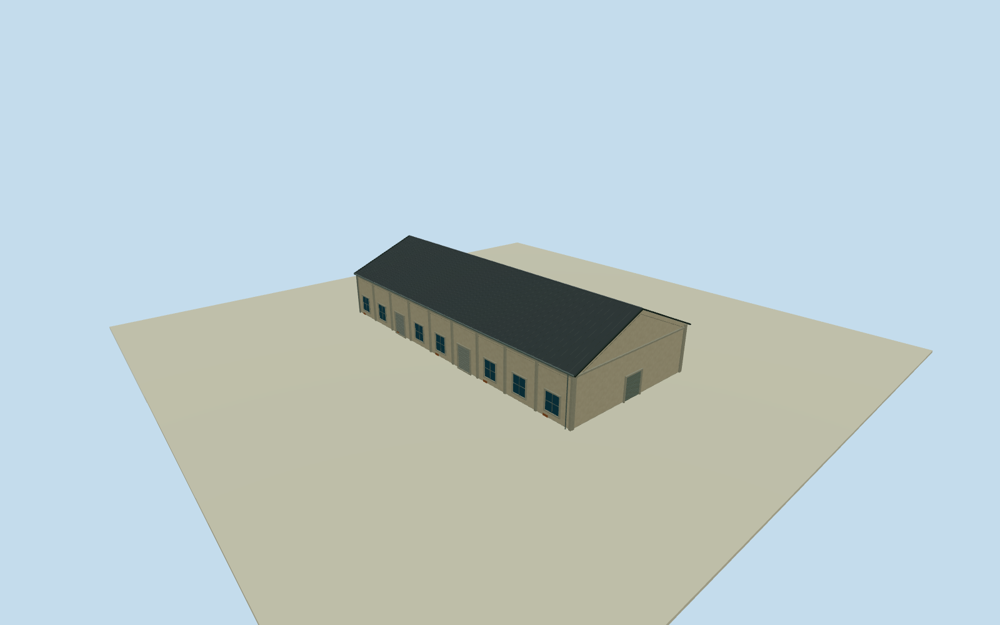

# Dayi C8 North Warehouse

Whole independent original northern Dayi C8warehouse203315639/refC8, all four outside controls/full walls/base/both gables/full pitched roof. Separate southern C8way394378149 and C7/C9 excluded. Already-cleared2015 C5overview supplies general local warehouse family only; all C8elevations/sections/census estimates. Original independent northern Dayi C8way203315639/refC8, four native corners, first short edge19.39m and second long edge43.73m. Separate southern C8body394378149, C7/C9 context. Exact cleared2015 C5overview53500205916 supplies only general Pier2warehouse stucco/concrete/gable roof/window/roller family; all C8elevations/height/sections/census estimated, no photographed C8label or exact front identification. Original0to1shortedge defines+Xwidth/+Zridge south, current plan is approximate2015registration. Whole independent native c8 north warehouse, all original controls, walls, base, two gables and full gray pitched roof. Separate neighboring bodies excluded. Exact already-cleared2015 C5overview53500205916 supplies general local pale weathered stucco/concrete framing/gray roof/bluegray window/roller vocabulary only. Every c8 north elevation, section and opening census estimated; no direct photograph label claim or copied B7oval/C7panel. Floor.25/foundation-1/eave6.45/ridge10.65 chosen once after original field and before geometry. Heights6.2/10.4m above floor have2m uncertainty. Original native corner relative grades[-0.698,0.22569989585246797,0.3875094570285149,0.8863537260463723]m; closing skirt is estimated buried extension, not surveyed basement. Historical ground/vertical tie unknown. Original frame/field unchanged; no flattening, masking or floor/roof refit. 9 estimated longwall bays/7 windows/two rollers each side, broad closed northern gable entry4.7m and smaller rear entry, concrete pilasters and small brick base repairs. Precise pitch/covering/.35moverhang/facing/openings/hidden details are local family estimates with2m uncertainty. Independent256m129x129field/16641heights/1rawtile/datum0.698m frozen before geometry. Isolated review plane shows above-floor exterior; raw turntables expose estimated skirt. Original unmasked field separately inspected. Qualla-first38families/zero conflicts previously screened. Reused exact already-cleared photographer53500205916/NSID137596559@N07 CC0original, primary creator/native owner/license9/original URL/dimensions/byte proof bound. Full original previously personally inspected; no repeated source queries/downloads. Signs/posters/art/people/vehicles/photo textures unused. All four LODs retain whole body/full roof/ridge/all walls/base/gables/pilasters/window-roller panels/closed entries. Higher LODs restore mullions/frames/gutters/flutes/corrugation. Parent Pier2 ensemble unfinished; accepted neighboring assets preserved.

Authoring state: **review-in-qa.json**. Current completion evidence is in [qa.json](qa.json) and the [completion ledger](../../../../qualla-structures/batches/qualla-002.PROGRESS.md).

- [Pier-2 Art Center](https://qualla.com/pier-2-art-center/)

Whole independent original northern Dayi C8warehouse203315639/refC8, all four outside controls/full walls/base/both gables/full pitched roof. Separate southern C8way394378149 and C7/C9 excluded. Already-cleared2015 C5overview supplies general local warehouse family only; all C8elevations/sections/census estimates.

Original independent northern Dayi C8way203315639/refC8, four native corners, first short edge19.39m and second long edge43.73m. Separate southern C8body394378149, C7/C9 context. Exact cleared2015 C5overview53500205916 supplies only general Pier2warehouse stucco/concrete/gable roof/window/roller family; all C8elevations/height/sections/census estimated, no photographed C8label or exact front identification. Original0to1shortedge defines+Xwidth/+Zridge south, current plan is approximate2015registration.

Whole independent native c8 north warehouse, all original controls, walls, base, two gables and full gray pitched roof. Separate neighboring bodies excluded. Exact already-cleared2015 C5overview53500205916 supplies general local pale weathered stucco/concrete framing/gray roof/bluegray window/roller vocabulary only. Every c8 north elevation, section and opening census estimated; no direct photograph label claim or copied B7oval/C7panel.

Floor.25/foundation-1/eave6.45/ridge10.65 chosen once after original field and before geometry. Heights6.2/10.4m above floor have2m uncertainty. Original native corner relative grades[-0.698,0.22569989585246797,0.3875094570285149,0.8863537260463723]m; closing skirt is estimated buried extension, not surveyed basement. Historical ground/vertical tie unknown. Original frame/field unchanged; no flattening, masking or floor/roof refit.

9 estimated longwall bays/7 windows/two rollers each side, broad closed northern gable entry4.7m and smaller rear entry, concrete pilasters and small brick base repairs. Precise pitch/covering/.35moverhang/facing/openings/hidden details are local family estimates with2m uncertainty.

Independent256m129x129field/16641heights/1rawtile/datum0.698m frozen before geometry. Isolated review plane shows above-floor exterior; raw turntables expose estimated skirt. Original unmasked field separately inspected.

Qualla-first38families/zero conflicts previously screened. Reused exact already-cleared photographer53500205916/NSID137596559@N07 CC0original, primary creator/native owner/license9/original URL/dimensions/byte proof bound. Full original previously personally inspected; no repeated source queries/downloads. Signs/posters/art/people/vehicles/photo textures unused.

All four LODs retain whole body/full roof/ridge/all walls/base/gables/pilasters/window-roller panels/closed entries. Higher LODs restore mullions/frames/gutters/flutes/corrugation. Parent Pier2 ensemble unfinished; accepted neighboring assets preserved.

Build: `node content/worldgen/source/places/ws/wsj/dayi_c8_north_warehouse/models/generate-house.mjs`. Add `--check` to verify exact regeneration. 4158 triangles; 5 materials; no embedded photographs.
