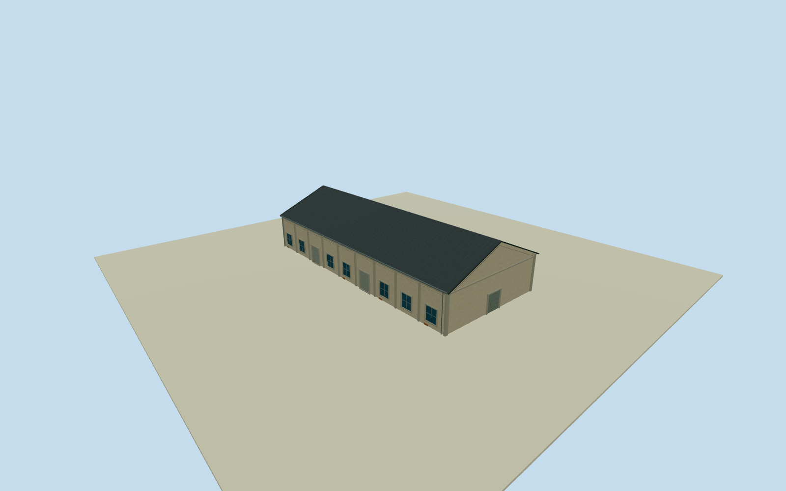

# Dayi C9 North Warehouse

Whole independent original northern Dayi C9 warehouse203315643/refC9, all four native outside controls/full walls/base/two gables/full pitched roof. Separate other C9body394378150 and neighboring warehouses excluded. Cleared2015 C5overview supplies general local Pier2warehouse family only, all C9elevations/sections/census estimates; no direct photographic member label asserted. Original independent northern Dayi C9way203315643/refC9, all four outside controls. Separate original other C9body394378150. First original0to1shortedge defines+Xwidth and signed+Zridge south, verified shorter than adjoining longwall before frame/field. Cleared2015 C5overview supplies general local construction family only; precise height/pitch/elevations/window-door census estimated. Current native outline approximately registers2015appearance, not historical survey. Whole independent native c9 north warehouse, all original controls, walls, base, two gables and full gray pitched roof. Separate neighboring bodies excluded. Exact already-cleared2015 C5overview53500205916 supplies general local pale weathered stucco/concrete framing/gray roof/bluegray window/roller vocabulary only. Every c9 north elevation, section and opening census estimated; no direct photograph label claim or copied B7oval/C7panel. Floor.25/foundation-0.75/eave6.45/ridge10.65 chosen once after original field and before geometry. Heights6.2/10.4m above floor have2m uncertainty. Original native corner relative grades[-0.08617368639584311,1.0181702090220481,0.7612641762296639,-0.48314778751922294]m; closing skirt is estimated buried extension, not surveyed basement. Historical ground/vertical tie unknown. Original frame/field unchanged; no flattening, masking or floor/roof refit. 9 estimated longwall bays/7 windows/two rollers each side, broad closed northern gable entry4.7m and smaller rear entry, concrete pilasters and small brick base repairs. Precise pitch/covering/.35moverhang/facing/openings/hidden details are local family estimates with2m uncertainty. Independent256m129x129field/16641heights/1rawtile/datum1.8062m frozen before geometry. Isolated review plane shows above-floor exterior; raw turntables expose estimated skirt. Original unmasked field separately inspected. Qualla-first38families/zero conflicts previously screened. Reused exact already-cleared photographer53500205916/NSID137596559@N07 CC0original, primary creator/native owner/license9/original URL/dimensions/byte proof bound. Full original previously personally inspected; no repeated source queries/downloads. Signs/posters/art/people/vehicles/photo textures unused. All four LODs retain whole body/full roof/ridge/all walls/base/gables/pilasters/window-roller panels/closed entries. Higher LODs restore mullions/frames/gutters/flutes/corrugation. Parent Pier2 ensemble unfinished; accepted neighboring assets preserved.

Authoring state: **review-in-qa.json**. Current completion evidence is in [qa.json](qa.json) and the [completion ledger](../../../../qualla-structures/batches/qualla-002.PROGRESS.md).

- [Pier-2 Art Center](https://qualla.com/pier-2-art-center/)

Whole independent original northern Dayi C9 warehouse203315643/refC9, all four native outside controls/full walls/base/two gables/full pitched roof. Separate other C9body394378150 and neighboring warehouses excluded. Cleared2015 C5overview supplies general local Pier2warehouse family only, all C9elevations/sections/census estimates; no direct photographic member label asserted.

Original independent northern Dayi C9way203315643/refC9, all four outside controls. Separate original other C9body394378150. First original0to1shortedge defines+Xwidth and signed+Zridge south, verified shorter than adjoining longwall before frame/field. Cleared2015 C5overview supplies general local construction family only; precise height/pitch/elevations/window-door census estimated. Current native outline approximately registers2015appearance, not historical survey.

Whole independent native c9 north warehouse, all original controls, walls, base, two gables and full gray pitched roof. Separate neighboring bodies excluded. Exact already-cleared2015 C5overview53500205916 supplies general local pale weathered stucco/concrete framing/gray roof/bluegray window/roller vocabulary only. Every c9 north elevation, section and opening census estimated; no direct photograph label claim or copied B7oval/C7panel.

Floor.25/foundation-0.75/eave6.45/ridge10.65 chosen once after original field and before geometry. Heights6.2/10.4m above floor have2m uncertainty. Original native corner relative grades[-0.08617368639584311,1.0181702090220481,0.7612641762296639,-0.48314778751922294]m; closing skirt is estimated buried extension, not surveyed basement. Historical ground/vertical tie unknown. Original frame/field unchanged; no flattening, masking or floor/roof refit.

9 estimated longwall bays/7 windows/two rollers each side, broad closed northern gable entry4.7m and smaller rear entry, concrete pilasters and small brick base repairs. Precise pitch/covering/.35moverhang/facing/openings/hidden details are local family estimates with2m uncertainty.

Independent256m129x129field/16641heights/1rawtile/datum1.8062m frozen before geometry. Isolated review plane shows above-floor exterior; raw turntables expose estimated skirt. Original unmasked field separately inspected.

Qualla-first38families/zero conflicts previously screened. Reused exact already-cleared photographer53500205916/NSID137596559@N07 CC0original, primary creator/native owner/license9/original URL/dimensions/byte proof bound. Full original previously personally inspected; no repeated source queries/downloads. Signs/posters/art/people/vehicles/photo textures unused.

All four LODs retain whole body/full roof/ridge/all walls/base/gables/pilasters/window-roller panels/closed entries. Higher LODs restore mullions/frames/gutters/flutes/corrugation. Parent Pier2 ensemble unfinished; accepted neighboring assets preserved.

Build: `node content/worldgen/source/places/ws/wsj/dayi_c9_north_warehouse/models/generate-house.mjs`. Add `--check` to verify exact regeneration. 4158 triangles; 5 materials; no embedded photographs.
