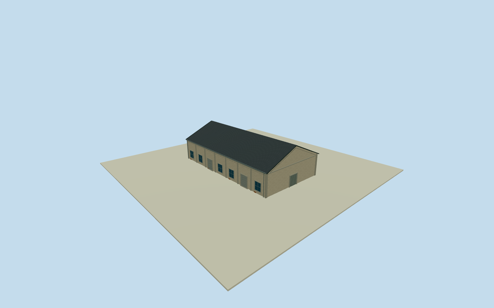

# Dayi Northeast Building

Whole independent native Dayi Northeast Building/way727825711, all four original outside controls/full walls/base/full roof. Unlabeled original native building within the broad Pier2 boundary; exact2015 role/appearance not established. Include as explicitly approximate ancillary physical coverage, without borrowing a named warehouse identity. Neighboring structures excluded. Whole original independent unlabeled building way727825711, all four native controls retained. Original1to2shortedge defines signed+Xwidth/+Zdepth before independentfield/floors/sections. Broadboundarycontainment alone is not ownership or2015identity proof; ancillary role/name descriptive only. Estimated local industrial envelope over complete mapped plan; no facade-only or wholepark proxy. Whole independent native Dayi Northeast Building warehouse, all original controls, walls, base, two gables and full gray pitched roof. Separate neighboring bodies excluded. Exact already-cleared2015 C5overview photograph53500205916 supplies general local pale weathered stucco/concrete framing/gray roof/bluegray window/roller vocabulary only. Every Dayi Northeast Building elevation, section and opening census estimated; no direct photograph label claim or copied B7oval/C7panel. Floor.25/foundation-2.15/eave6.45/ridge10.65 chosen once after original field and before geometry. Heights6.2/10.4m above floor have2m uncertainty. Original native corner relative grades[-0.47109509308265274,1.271494407461918,0.6110155444306766,-1.8823825422115685]m; closing skirt is estimated buried extension, not surveyed basement. Historical ground/vertical tie unknown. Original frame/field unchanged; no flattening, masking or floor/roof refit. 7 estimated longwall bays/5 windows/two rollers each side, broad closed negative-Z gable entry4.7m and smaller rear entry, concrete pilasters and small brick base repairs. Precise pitch/covering/.35moverhang/facing/openings/hidden details are local family estimates with2m uncertainty. Independent256m129x129field/16641heights/1rawtile/datum2.873m frozen before geometry. Isolated review plane shows above-floor exterior; raw turntables expose estimated skirt. Original unmasked field separately inspected. Qualla-first38families/zero conflicts previously screened. Reused exact already-cleared photographer53500205916/NSID137596559@N07 CC0original, primary creator/native owner/license9/original URL/dimensions/byte proof bound. Full original previously personally inspected; no repeated source queries/downloads. Signs/posters/art/people/vehicles/photo textures unused. All four LODs retain the native tapered envelope; facade panels, pilasters, both gables and roof are bilinearly mapped to the original four controls with recomputed outward normals. Original source frame/field unchanged. All four LODs retain whole body/full roof/ridge/all walls/base/gables/pilasters/window-roller panels/closed entries. Higher LODs restore mullions/frames/gutters/flutes/corrugation. Parent Pier2 ensemble unfinished; accepted neighboring assets preserved. Unlabeled native building: exact internal function, historical2015survival/appearance and roof type are unverified. Descriptive geographic name only. Current original plan is approximately placed into the selected2015local-family interpretation; all own elevations and roof sections explicitly estimated. This is approximate ancillary coverage, not a named warehouse identification.

Authoring state: **review-in-qa.json**. Current completion evidence is in [qa.json](qa.json) and the [completion ledger](../../../../qualla-structures/batches/qualla-002.PROGRESS.md).

- [Pier-2 Art Center](https://qualla.com/pier-2-art-center/)

Whole independent native Dayi Northeast Building/way727825711, all four original outside controls/full walls/base/full roof. Unlabeled original native building within the broad Pier2 boundary; exact2015 role/appearance not established. Include as explicitly approximate ancillary physical coverage, without borrowing a named warehouse identity. Neighboring structures excluded.

Whole original independent unlabeled building way727825711, all four native controls retained. Original1to2shortedge defines signed+Xwidth/+Zdepth before independentfield/floors/sections. Broadboundarycontainment alone is not ownership or2015identity proof; ancillary role/name descriptive only. Estimated local industrial envelope over complete mapped plan; no facade-only or wholepark proxy.

Whole independent native Dayi Northeast Building warehouse, all original controls, walls, base, two gables and full gray pitched roof. Separate neighboring bodies excluded. Exact already-cleared2015 C5overview photograph53500205916 supplies general local pale weathered stucco/concrete framing/gray roof/bluegray window/roller vocabulary only. Every Dayi Northeast Building elevation, section and opening census estimated; no direct photograph label claim or copied B7oval/C7panel.

Floor.25/foundation-2.15/eave6.45/ridge10.65 chosen once after original field and before geometry. Heights6.2/10.4m above floor have2m uncertainty. Original native corner relative grades[-0.47109509308265274,1.271494407461918,0.6110155444306766,-1.8823825422115685]m; closing skirt is estimated buried extension, not surveyed basement. Historical ground/vertical tie unknown. Original frame/field unchanged; no flattening, masking or floor/roof refit.

7 estimated longwall bays/5 windows/two rollers each side, broad closed negative-Z gable entry4.7m and smaller rear entry, concrete pilasters and small brick base repairs. Precise pitch/covering/.35moverhang/facing/openings/hidden details are local family estimates with2m uncertainty.

Independent256m129x129field/16641heights/1rawtile/datum2.873m frozen before geometry. Isolated review plane shows above-floor exterior; raw turntables expose estimated skirt. Original unmasked field separately inspected.

Qualla-first38families/zero conflicts previously screened. Reused exact already-cleared photographer53500205916/NSID137596559@N07 CC0original, primary creator/native owner/license9/original URL/dimensions/byte proof bound. Full original previously personally inspected; no repeated source queries/downloads. Signs/posters/art/people/vehicles/photo textures unused.

All four LODs retain the native tapered envelope; facade panels, pilasters, both gables and roof are bilinearly mapped to the original four controls with recomputed outward normals. Original source frame/field unchanged. All four LODs retain whole body/full roof/ridge/all walls/base/gables/pilasters/window-roller panels/closed entries. Higher LODs restore mullions/frames/gutters/flutes/corrugation. Parent Pier2 ensemble unfinished; accepted neighboring assets preserved.

Unlabeled native building: exact internal function, historical2015survival/appearance and roof type are unverified. Descriptive geographic name only. Current original plan is approximately placed into the selected2015local-family interpretation; all own elevations and roof sections explicitly estimated. This is approximate ancillary coverage, not a named warehouse identification.

Build: `node content/worldgen/source/places/ws/wsj/dayi_northeast_building/models/generate-house.mjs`. Add `--check` to verify exact regeneration. 3810 triangles; 5 materials; no embedded photographs.
